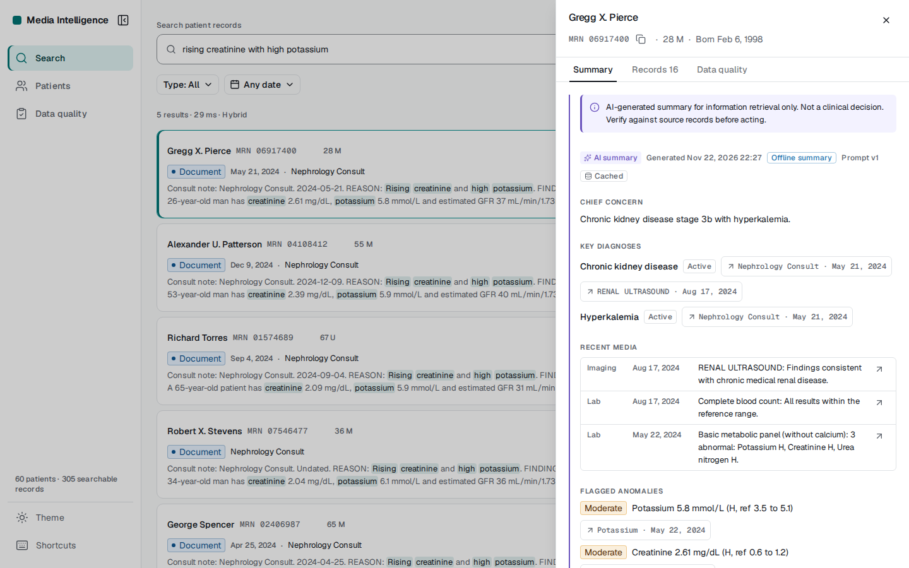
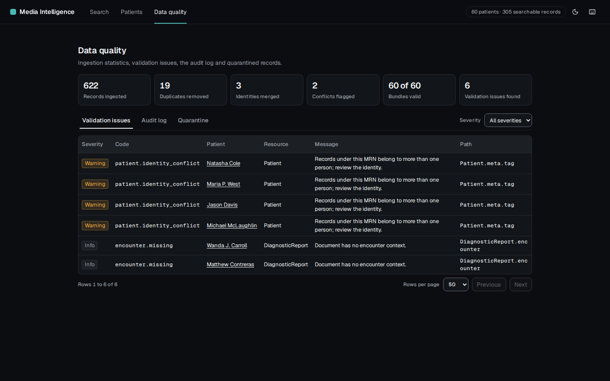
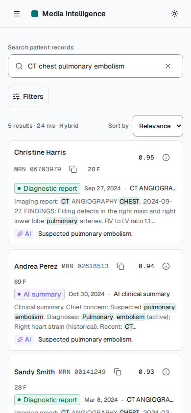

<p align="center">
  
</p>

# EHR Media Intelligence Platform

A pipeline and web app for unstructured EHR records. It ingests messy exports (JSON, CSV and text notes), cleans and normalizes them to HL7 FHIR R4, writes summaries that cite their source records, and lets a clinician search every record by meaning. Built for the Onye AI full-stack assessment. All data is synthetic.



Live demo: [ehr-mi-demo-7c41.onrender.com](https://ehr-mi-demo-7c41.onrender.com) (sign-in required; the free server can take about 3 minutes to wake). API docs: [ehr-mi-api-7c41.onrender.com/docs](https://ehr-mi-api-7c41.onrender.com/docs).

Summaries can come from an AI model (Claude, or the free Groq model `openai/gpt-oss-120b`) and are checked against the source records before they are shown. It also runs fully without any key: summaries then come from an offline extractive summarizer, labeled "Offline summary". The one-page write-up is [docs/WRITEUP.pdf](docs/WRITEUP.pdf) and the AI system card is [docs/AI_SYSTEM_CARD.md](docs/AI_SYSTEM_CARD.md).

<details>
<summary>More screenshots</summary>





</details>

## Quick start with Docker

```bash
cp .env.example .env
docker compose up
```

Open http://localhost:8080. The first start builds two images (the API image is about 2.8 GB, mostly CPU PyTorch and the embedding model) and runs the pipeline into an empty volume. No key is needed.

To share the search cache and rate limits through Redis:

```bash
docker compose --profile redis up
```

`/api/ready` then reports `"cache_backend": "redis"`. The web port listens on 127.0.0.1 only, because the app has no login. `WEB_BIND` and `WEB_PORT` change that.

## Free demo deployment

[docs/DEPLOY.md](docs/DEPLOY.md) deploys the frontend and API on Render's free plan from [render.yaml](render.yaml), with synthetic data and a banner that says so. Render never holds a model key: model summaries are made on a developer machine and shipped in [data/summaries/](data/summaries/) once they pass the quality gates; until then the demo shows offline summaries. You enter your own sign-in email and password once in the Render dashboard. Swagger docs are published at `/docs` on the API URL.

## Sign-in

Every page and data route needs a session. Create an account once, then sign in at `/signin`:

```bash
cd backend && uv run ehr-mip users add --email you@example.org --name "Your name"
```

The password is asked for twice (at least 12 characters). `ehr-mip users disable --email ...` blocks an account and ends its sessions. To create an account when the API starts (as on Render), set `SEED_ACCOUNT_EMAIL`, `SEED_ACCOUNT_PASSWORD` and optionally `SEED_ACCOUNT_NAME` in `.env`. `make e2e` and `make lighthouse` create their own test account.

## Local development

Requirements: Python 3.12, [uv](https://docs.astral.sh/uv/), Node 22, pnpm and git.

```bash
make setup      # backend and frontend dependencies, git hooks
make data       # regenerate the seeded synthetic data in data/raw/
make pipeline   # ingest, normalize, summarize, index (idempotent)
make dev        # API on :8000 and web app on http://localhost:5173
```

The first `make pipeline` downloads the embedding model (about 90 MB) into `data/generated/hf-cache`. Settings are environment variables, documented in [.env.example](.env.example). `make` on its own lists every target.

## Tests

| Command | What it runs |
|---|---|
| `make check` | ruff, import-linter, mypy `--strict`, pytest with an 85 percent coverage gate (96 percent now), ESLint, Prettier, tsc and Vitest |
| `cd backend && uv run pytest` | The backend suite alone, with coverage |
| `make e2e` | Playwright on its own servers and a copy of the data, with axe in both themes. Needs `make pipeline` and Chromium (below) |
| `cd frontend && pnpm test-storybook` | Every story with axe and its play function |
| `make eval` | Summary quality gates, written to [reports/eval_report.md](reports/eval_report.md) |
| `make lighthouse` | Bundle budget and Lighthouse CI on the production build |
| `make security` | pip-audit, pnpm audit, gitleaks, and Trivy once the images are built |
| `make writeup-pdf` | Renders the write-up and fails if it is longer than one page |

The browser targets use a project-local Chromium:

```bash
cd frontend && PLAYWRIGHT_BROWSERS_PATH=0 pnpm exec playwright install chromium
```

Tests never call the Claude API. GitHub Actions is switched off for this repository, so these commands are the gates and are run by hand (see [Known limitations](#known-limitations)).

Lighthouse on 2026-11-22, median of three runs, production build, development laptop on mains power:

| Page | Performance | Accessibility | Best practices | Performance on simulated slow 4G (not gated) |
|---|---|---|---|---|
| Home | 100 | 100 | 100 | 94 |
| Search results | 100 | 100 | 100 | 86 |
| Patients | 99 | 100 | 100 | 93 |
| Data quality | 100 | 100 | 100 | 97 |

The gate is 90 at 4x CPU slowdown without network throttling ([docs/06](docs/06-UI-DESIGN.md) section 15). Scores follow the machine's CPU speed: on battery the same laptop gave medians of 95 to 100 at the gated profile, apart from one run under load that failed at 88, and 72 to 88 on slow 4G. Initial JS is 240.0 KB gzip against a budget of 250 KB. Web Vitals and usability findings are in the [heuristic review](docs/ux/heuristic-review.md).

## Pipeline CLI

Run from `backend/` as `uv run ehr-mip <command>`, or use the make target.

| Command | Make target | What it does | Result on the bundled data |
|---|---|---|---|
| `ingest` | `make ingest` | Reads three formats, cleans each field with an audit entry, resolves identities, removes duplicates | 622 records in, 60 patients, 19 duplicates removed, 3 merges, 2 conflicts, 3 quarantined |
| `normalize` | `make normalize` | Builds and validates one FHIR Bundle per patient | 60 of 60 valid, [report](reports/validation_report.md) |
| `summarize` | `make summarize` | One grounded summary of at most 200 words per patient, cached by bundle hash, prompt and model | 60 summaries, and a second run makes no model calls |
| `index` | `make index` | Chunks, scrubs identifiers, embeds locally and indexes | 305 chunks from 245 records and 60 summaries |
| `run-all` | `make pipeline` | The four stages in order | Idempotent |
| `serve` | `make api` | Serves the API | Port 8000 |
| `eval` | `make eval` | Scores summaries against golden, adversarial and ground truth sets | All automatic gates pass |

The rules for every stage are in [docs/05-ALGORITHMS.md](docs/05-ALGORITHMS.md).

## AI summaries

| Provider | Key in `.env` | Model | Notes |
|---|---|---|---|
| Claude | `ANTHROPIC_API_KEY` | `claude-haiku-5-5` | The brief's choice. Structured output. Needs API credit |
| Groq | `GROQ_API_KEY` | `openai/gpt-oss-120b` | Free tier with daily limits. JSON schema output ([ADR-014](docs/decisions/ADR-014-groq-and-shipped-summaries.md)) |
| Offline | none | none | Rule-based extraction, always available |

`LLM_PROVIDER=auto` uses Claude when its key is set, then Groq, else offline. `LLM_PROVIDER=groq` picks Groq even when a Claude key is present. Every provider gets the same de-identified context and the same checks: claims must cite real records, at most 200 words, a confidence score and a disclaimer. A failed call falls back to the offline summary for that patient, and results are cached by patient, data, prompt and model, so a second run makes no calls.

To refresh the summaries the demo ships:

```bash
make pipeline
cd backend && uv run ehr-mip summaries export   # writes data/summaries/summaries.json
```

`run-all` imports that file before summarizing, and a summary is only used while its patient's data is unchanged.

## API

The contract with examples is [docs/04-API-CONTRACT.md](docs/04-API-CONTRACT.md). A snapshot test compares it with [docs/openapi.json](docs/openapi.json), and the frontend parses every example with its Zod schemas. Swagger docs are at http://localhost:8000/docs in development and at [ehr-mi-api-7c41.onrender.com/docs](https://ehr-mi-api-7c41.onrender.com/docs) on the demo (`API_DOCS_ENABLED`). Data routes need a sign-in.

| Endpoint | Purpose |
|---|---|
| `POST /search` | Hybrid or semantic search with type, date and patient filters, MRN lookup, and `sort=newest` |
| `GET /patients` | Directory with search, sort and paging |
| `GET /patients/{key}` | Patient header |
| `GET /patients/{key}/summary` | Summary with evidence, confidence and provenance |
| `POST /patients/{key}/summary/feedback` | Helpful or not helpful, with a reason |
| `GET /patients/{key}/resources` | Linked FHIR resources |
| `GET /patients/{key}/audit` | Masked audit entries for one patient |
| `GET /resources/{type}/{id}` | One resource as readable text and FHIR JSON |
| `GET /quality/overview`, `/validation`, `/audit`, `/quarantine` | Data quality, all under `/quality` |
| `POST /auth/login`, `/auth/logout`, `GET /auth/me` | Sign-in and the session cookie |
| `GET /stats`, `/health`, `/ready`, `/metrics` | Counts, probes and Prometheus metrics |

```bash
curl -s -c cookies -X POST http://localhost:8000/auth/login -H 'X-Requested-With: ehr-mip' \
  -H 'Content-Type: application/json' -d '{"email": "you@example.org", "password": "..."}'
curl -s -b cookies -X POST 'http://localhost:8000/search?resource_type=DiagnosticReport&date_from=2024-06-01' \
  -H 'Content-Type: application/json' -H 'X-Requested-With: ehr-mip' \
  -d '{"query": "worsening kidney function with high potassium"}'
```

Every POST needs the `X-Requested-With: ehr-mip` header. Errors are RFC 9457 problem documents. Routes are rate limited and answer with `RateLimit-*` headers.

## Design decisions

| Decision | Why |
|---|---|
| [FHIR R4B package for R4](docs/decisions/ADR-001-fhir-resources-r4b.md) | The only R4 family models on Pydantic v2 |
| [ChromaDB in process](docs/decisions/ADR-002-chromadb.md) | Metadata filters and persistence without a service |
| [One resource per result](docs/decisions/ADR-003-result-unit-resource.md) | A result is a record a clinician can open and cite |
| [UUIDv5 ids](docs/decisions/ADR-004-uuidv5-ids.md) | Idempotent runs and stable caches |
| [De-identified model context](docs/decisions/ADR-005-deidentified-llm-context.md) | Privacy and a smaller surface for hallucination |
| [Extractive fallback](docs/decisions/ADR-006-extractive-fallback.md) | Works offline and when a call fails |
| [Conservative identity](docs/decisions/ADR-007-conservative-identity.md) | A wrong merge is worse than a missed one |
| [US date policy](docs/decisions/ADR-008-us-date-policy.md) | Every guess is flagged |
| [Standard library SQLite](docs/decisions/ADR-009-stdlib-sqlite.md) | Visible SQL and no service |
| [TanStack Router](docs/decisions/ADR-010-tanstack-router.md) | Searches are validated, shareable URLs |
| [Optional Redis](docs/decisions/ADR-011-optional-redis.md) | Needed only with several API processes |
| [The limits library](docs/decisions/ADR-012-slowapi.md) | The headers the contract names |

The specification is in [docs/01-SPEC.md](docs/01-SPEC.md), the architecture in [docs/02-ARCHITECTURE.md](docs/02-ARCHITECTURE.md), the design system in [docs/06-UI-DESIGN.md](docs/06-UI-DESIGN.md) and the threat model in [docs/09-SECURITY.md](docs/09-SECURITY.md).

## Data and privacy

- **Synthetic only.** A seeded generator builds 60 fictional patients and injects the problems the pipeline must handle, listed in `data/raw/_ground_truth.json`. Names come from Faker and phone numbers use the reserved 555-01xx range. After `make data`, `git diff data/raw` is empty unless the data and the generator have drifted apart.
- **Model context.** Age, sex and clinical text, with the patient's own identifiers and common contact formats removed. This is not Safe Harbor de-identification ([ADR-005](docs/decisions/ADR-005-deidentified-llm-context.md)).
- **Logs.** Ids and routes without query strings. No names, MRNs, birth dates or note text.
- **Audit views.** Identity values are masked. Patient responses are never written to Redis.
- **Containers.** Non-root, read-only file system, no capabilities, images pinned by digest and a strict Content-Security-Policy.

## Project structure

```
backend/    Python package ehr_mip (uv): ingestion, fhir, summarization, search, api layers
frontend/   React 19, Vite, Tailwind v4, shadcn/ui (Base UI), TanStack Router, Query and Table
scripts/    data generator, isolated e2e API, Lighthouse, image scan and write-up renderer
data/raw/   committed synthetic input; data/generated/ holds local state (gitignored)
data/summaries/  AI summaries made offline and shipped with the demo
docs/       specification, architecture, contract, design system, ADRs, system card, write-up
reports/    committed samples of the validation and evaluation reports
```

Backend layers import downward only (`api > search > summarization > fhir > ingestion > db`), enforced by import-linter.

## Known limitations

- **No automatic CI.** The workflows in `.github/workflows` have never completed a run on GitHub: hosted runners are not available to this account, so the CI, Security and eval workflows are switched off. The checks were run locally with the commands under [Tests](#tests), and the workflow steps were rehearsed on a clean clone. CodeQL has not run at all. The failed runs on earlier commits never started a job.
- **Simple sign-in only.** Email and password with server-side sessions ([ADR-013](docs/decisions/ADR-013-sessions.md)). No single sign-on, roles, password reset or record of who viewed which patient. Never load real patient data. The only configuration meant to be public is the synthetic demo in [docs/DEPLOY.md](docs/DEPLOY.md).
- **Claude has not produced a summary here.** The trial account had no credit, so the API refused every call. Groq's open model was run on all 60 patients instead: every claim cited a real record, but it failed 4 of 7 quality gates ([report](docs/eval/eval_report_groq.md)), so its summaries are not shipped as the default yet ([ADR-014](docs/decisions/ADR-014-groq-and-shipped-summaries.md)). The manual review of summaries is still to be done by a person.
- **Extractive recall is 87.5 percent.** It misses all 6 expected cases of hyponatremia and 6 of the 12 of hyperlipidemia.
- **De-identification is partial.** Dates stay, and other people's names inside note text are not detected.
- **Accepted vulnerabilities.** Four ChromaDB server advisories (the server is never run) and 12 Debian advisories without a fix, the latter until 2026-12-22 ([docs/09](docs/09-SECURITY.md) section 8.1). After that date `make security` fails until they are reviewed.
- **A blind spot in the image scan.** The ChromaDB wheel bundles SQLite 3.46.0, which Trivy does not see and which is in the affected range of two FTS5 advisories. Their reachability has not been established.
- **One node.** SQLite and in-process Chroma suit one API process.
- **Not built (P2).** Timeline, bundle download, regenerate from the UI, admin endpoints, the HL7 validator target, visual regression and a usability test with people.
- **Newest order matches words, not meaning.** Sort by Newest finds the most recent record with every search word. It misses synonyms and abbreviations, and a negated mention still matches.
- **Date presets.** They count back from today and the demo data ends in 2025, so most return nothing.
- **Usability.** Thirteen minor findings are open in the [heuristic review](docs/ux/heuristic-review.md). Only Chromium was tested, and no screen reader.
