# 02. Architecture

All diagrams are Mermaid and render on GitHub. Keep them in sync with the code; update the diagram in the same PR as the change.

## 1. System context (C4 level 1)

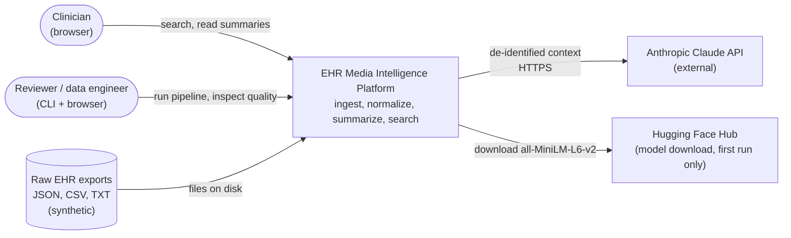

## 2. Containers (C4 level 2)

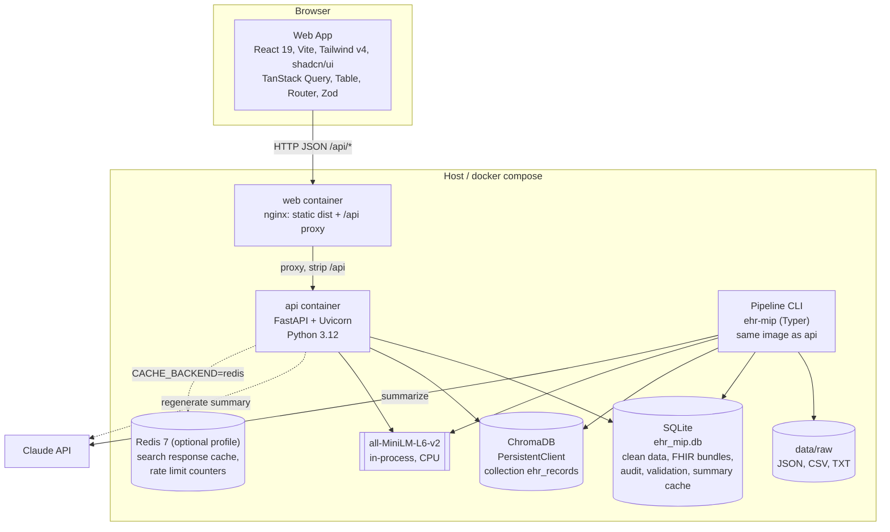

In local dev, Vite's dev server replaces nginx and proxies `/api` to `localhost:8000`.

## 3. Backend components (C4 level 3)

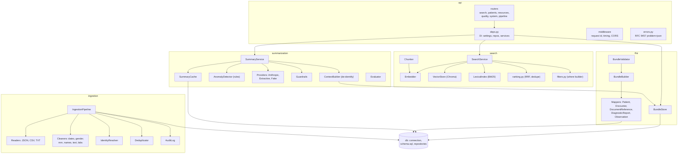

**Dependency rule:** arrows only point down the stack `api → search → summarization → fhir → ingestion → db`. Enforced with an import-linter contract in CI (`importlinter` layers contract).

## 4. Frontend architecture

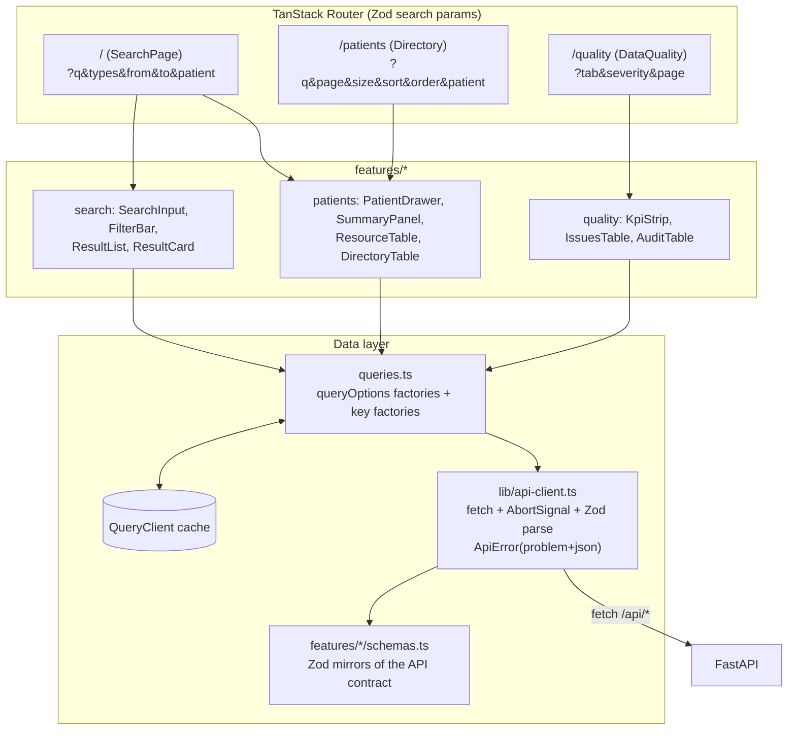

State ownership: **URL** owns search query, filters, open patient, table paging. **TanStack Query** owns server data. **Component state** owns only ephemeral UI (popover open, input draft before debounce). No global store library.

## 5. Pipeline flow

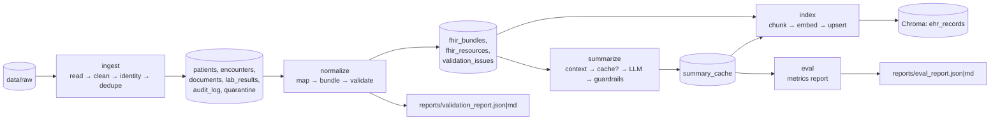

Every stage is idempotent: deterministic ids, `INSERT OR REPLACE`, Chroma `upsert`, cache keyed by content hash.

### 5.1 Sequence: `ehr-mip run-all`

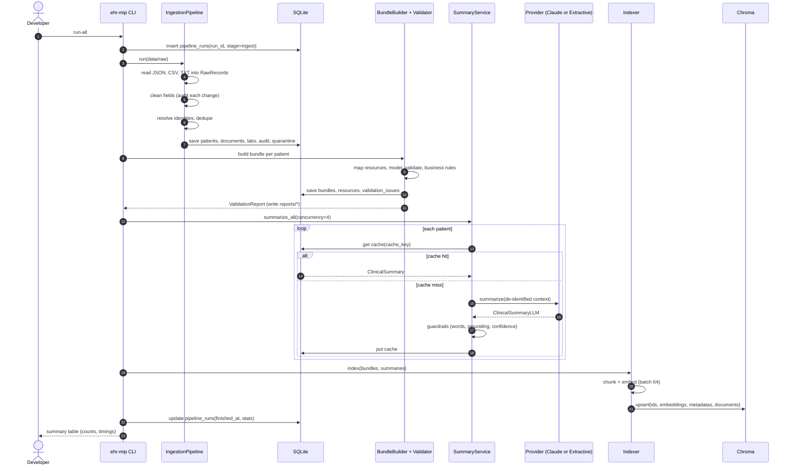

## 6. Request flows

### 6.1 Sequence: real-time search

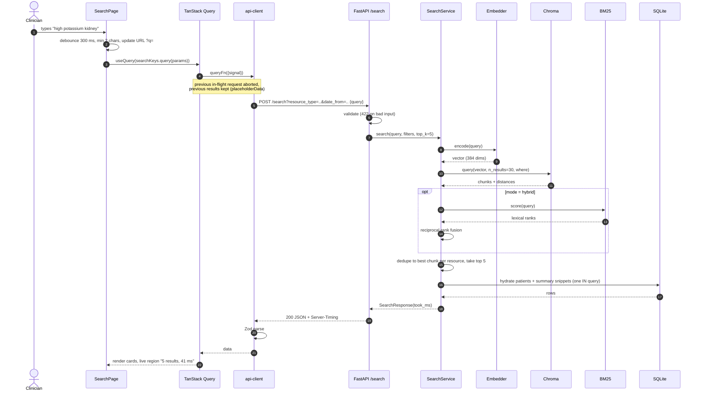

### 6.2 Sequence: open patient drawer

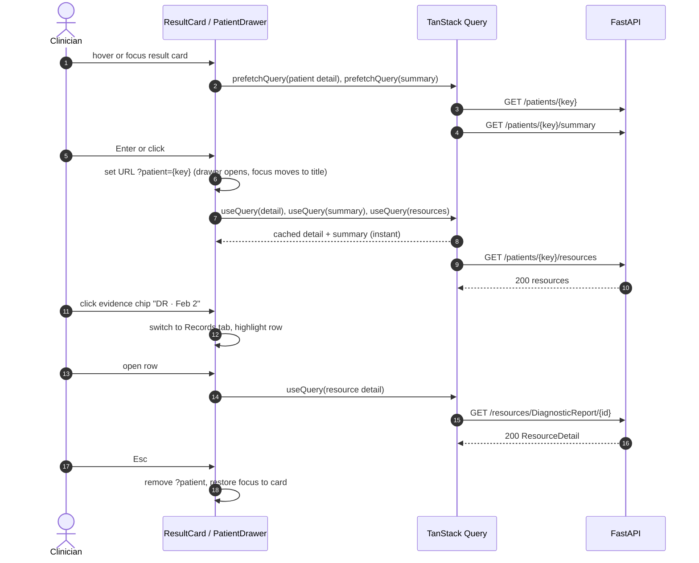

### 6.3 Sequence: summary generation with cache, guardrails and fallback

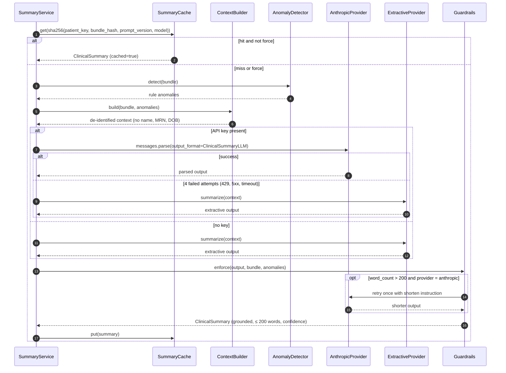

## 7. Deployment

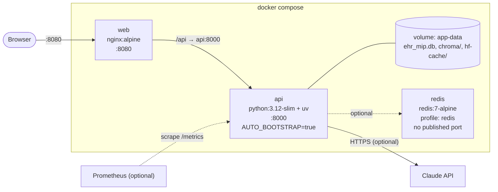

- `api` image pre-downloads the embedding model in a build layer and runs the pipeline on start if the DB is empty (`AUTO_BOOTSTRAP=true`).
- `web` image builds the Vite app and serves `dist/` with an nginx `location /api/ { proxy_pass http://api:8000/; }`.
- Health checks: `api` uses `GET /ready`; `web` depends on `api` healthy.

## 8. Caching architecture

Caches are layered. Each has one owner, a clear key and an explicit invalidation rule. SQLite is the system of record for summaries (the brief asks for a file or SQLite cache); Redis is an optional shared backend for short-lived caches and rate limit counters, selected with `CACHE_BACKEND=memory|redis`.

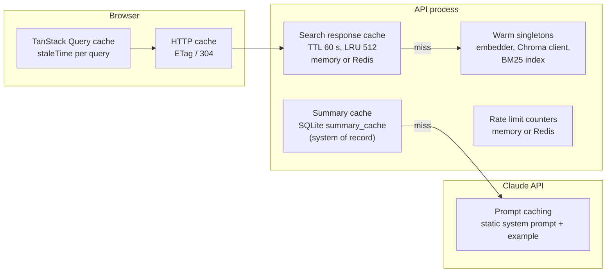

| Cache | Key | TTL / lifetime | Invalidation | Backend |
|---|---|---|---|---|
| TanStack Query | query key factory (`04-API-CONTRACT.md` §11.1) | staleTime per query | mutation `setQueryData` / `invalidateQueries` | browser memory |
| HTTP ETag | `"{bundle_hash}:{prompt_version}"` | until data changes | new hash | browser |
| Search responses | `search:{index_version}:{sha256(normalized query, filters, top_k, mode)}` | 60 s | `index_version` bumps on every `ehr-mip index` run, so old keys die naturally. It is the count of finished `index` runs in `pipeline_runs`, so the API process sees a reindex done by the CLI; the API reloads Chroma and BM25 when it changes | in-process `cachetools.TTLCache` or Redis |
| Patient detail / resources | `patient:{bundle_hash}:{key}` | 5 min | new bundle hash | same as above |
| Summaries | `sha256(patient_key, bundle_hash, prompt_version, model)` | permanent | content-addressed: new data or prompt gives a new key | SQLite |
| Embedder, Chroma, BM25 | process lifetime | until restart or reindex signal | `POST /pipeline/runs` (admin) reloads BM25 and bumps `index_version` | memory |
| Rate limit counters | `rl:{route}:{ip}` | window length | automatic | memory or Redis |
| LLM prompt caching | provider side, static system prompt and few-shot block marked cacheable (only effective once that prefix exceeds the model's minimum cacheable length) | provider TTL | prompt version change | Anthropic |

Cache values never contain PHI in Redis: search cache stores result ids, scores, snippets and is keyed by a hash, and Redis is internal-only with no persistence. Every cache emits hit and miss counters to `/metrics`.

### 8.1 Sequence: search with response cache

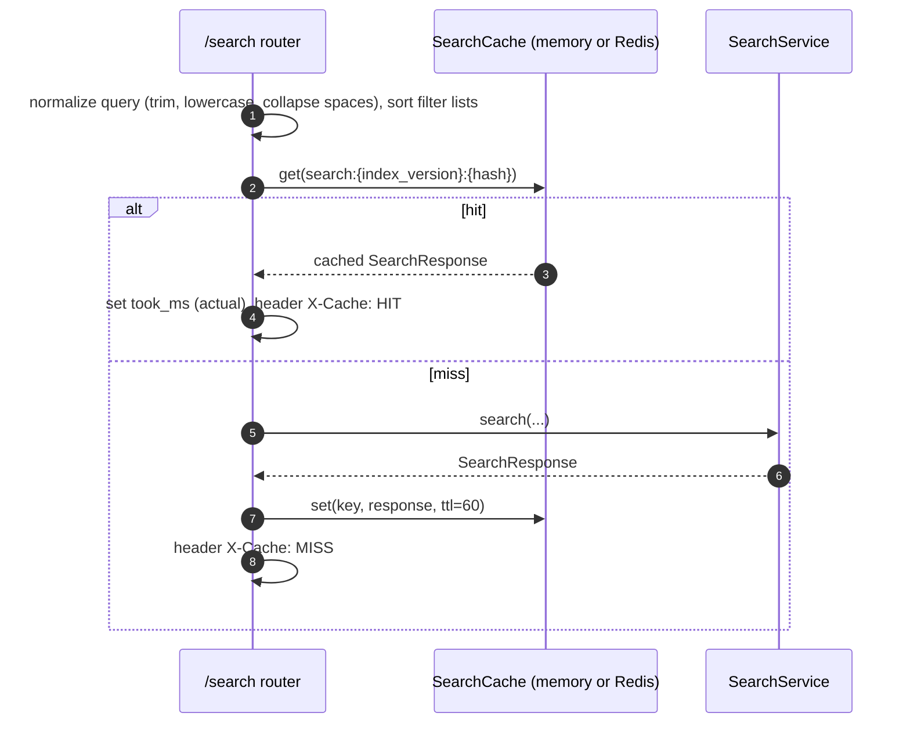

## 9. Cross-cutting concerns

| Concern | Approach |
|---|---|
| Configuration | `pydantic-settings` `Settings` loaded once, injected via `Depends(get_settings)`; frontend reads only `import.meta.env.VITE_*` (none required with proxy) |
| Errors | Domain exceptions → RFC 9457 problem+json (see `04-API-CONTRACT.md` section 2.3) |
| Logging | structlog JSON: `ts, level, event, request_id, route, status, duration_ms, patient_key?`. Never names, MRNs, DOB, note text |
| Tracing headers | `X-Request-ID` (echoed or generated), `Server-Timing: embed;dur=.., vector;dur=.., hydrate;dur=..` |
| Concurrency | SQLite WAL, one connection per request via dependency; Chroma client and embedder are app-scoped singletons on `app.state` |
| Startup | FastAPI lifespan: load settings, open SQLite, load and warm embedder, open Chroma collection, build BM25 index |
| Security | Full controls in `09-SECURITY.md`: headers, rate limits, input limits, redaction, admin token, hardened containers |
| Privacy | Synthetic data; LLM sees age, sex and clinical text only |
| Metrics | `prometheus-fastapi-instrumentator` at `/metrics` plus custom counters: search latency histogram, cache hits/misses per cache, LLM calls/tokens/latency, guardrail interventions |
| Shutdown | Lifespan exit closes SQLite, flushes logs, cancels in-flight summary tasks; Uvicorn `--timeout-graceful-shutdown 10` |
| Feature flags | Settings booleans (`SEARCH_MODE`, `INDEX_OBSERVATIONS`, `ENABLE_ADMIN_ENDPOINTS`, `CACHE_BACKEND`), exposed read-only in `/ready` so the UI can adapt |

## 10. Repository layout

```
ehr-media-intelligence/
├── AGENTS.md  CLAUDE.md  README.md  LICENSE
├── Makefile  docker-compose.yml  .env.example  .gitignore  .pre-commit-config.yaml
├── .github/ (workflows/ci.yml, security.yml, eval.yml; dependabot.yml; CODEOWNERS; pull_request_template.md; ISSUE_TEMPLATE/)
├── .editorconfig  .commitlintrc.json  CHANGELOG.md  SECURITY.md
├── data/raw/ (ehr_export.json, lab_results.csv, notes/*.txt, _ground_truth.json)
├── data/generated/            # gitignored
├── reports/                   # generated reports (samples committed)
├── scripts/ (generate_synthetic_data.py, export_openapi.py)
├── docs/ (01..10 *.md, openapi.json, AI_SYSTEM_CARD.md, WRITEUP.md, WRITEUP.pdf, decisions/ADR-*.md, eval/, ux/, design-refs/)
├── backend/
│   ├── pyproject.toml  uv.lock  requirements.txt  Dockerfile
│   ├── src/ehr_mip/
│   │   ├── config.py  errors.py  logging.py  cli.py
│   │   ├── db/ (schema.sql, connection.py, repositories.py)
│   │   ├── ingestion/ (models.py, audit.py, identity.py, dedupe.py, pipeline.py, readers/, cleaners/)
│   │   ├── fhir/ (codes.py, ids.py, bundle.py, validator.py, store.py, mappers/)
│   │   ├── summarization/ (schemas.py, context.py, anomalies.py, guardrails.py, cache.py, service.py, evaluate.py, telemetry.py, feedback.py, providers/, prompts/v1/)
│   │   ├── search/ (chunker.py, embedder.py, vector_store.py, lexical.py, ranking.py, filters.py, indexer.py, service.py)
│   │   ├── cache/ (backend.py: CacheBackend protocol, MemoryBackend, RedisBackend)
│   │   ├── observability/ (metrics.py, log_redaction.py)
│   │   └── api/ (main.py, deps.py, errors.py, middleware.py, security_headers.py, rate_limit.py, schemas/, routers/)
│   └── tests/ (conftest.py, fixtures/ incl. golden/, unit/, integration/, perf/, contract/, security/)
└── frontend/
    ├── package.json  vite.config.ts  components.json  eslint.config.js  playwright.config.ts  lighthouserc.json  Dockerfile  nginx.conf
    ├── .storybook/
    ├── e2e/
    └── src/ (main.tsx, index.css, router.tsx, app/, routes/, features/{search,patients,quality}/, components/{ui,common}/, lib/, test/)
```

## 11. Architecture decision records

Write each as `docs/decisions/ADR-00N-*.md` (context, decision, consequences).

| ADR | Decision | Rejected | Reason |
|---|---|---|---|
| 001 | `fhir.resources` 8.x using sub-package `R4B` | `fhir.resources` 6.x (R4 on Pydantic v1); `fhirclient` | Brief requires Pydantic v2. Since 7.0 the package ships R4B, not pure R4. R4B keeps Patient, Encounter, DocumentReference, DiagnosticReport, Observation and Bundle structurally compatible with R4. Optional HL7 validator run with `-version 4.0.1` |
| 002 | ChromaDB | FAISS | Native metadata filters (type, date) and persistence |
| 003 | Search result unit = one FHIR resource (best chunk) | Raw chunks | Brief asks for "patient record matches" |
| 004 | UUIDv5 ids from stable source facts | uuid4 | Idempotent runs, stable cache keys and vector ids |
| 005 | De-identified LLM context | Whole bundle | Privacy, fewer tokens, smaller hallucination surface |
| 006 | Extractive fallback summarizer | Fail without key | System runs offline for reviewers |
| 007 | Conservative identity resolution | Aggressive fuzzy merge | Wrong merges are clinically dangerous |
| 008 | Ambiguous dates parsed as US MM/DD with warning audit | Silent guess | Epic US source; every guess visible |
| 009 | stdlib `sqlite3` + repositories | SQLAlchemy ORM | Small schema, transparent SQL, fewer deps |
| 010 | TanStack Router with Zod search params | React Router | Typed, validated URL state for shareable searches |
| 011 | Redis optional, memory TTL cache default | Redis required | Single process and small data; Redis adds value only when scaling to several API replicas. Interface `CacheBackend` keeps the switch to one setting |
| 012 | slowapi for rate limiting | Custom middleware | Mature, supports memory and Redis storage, standard headers |
