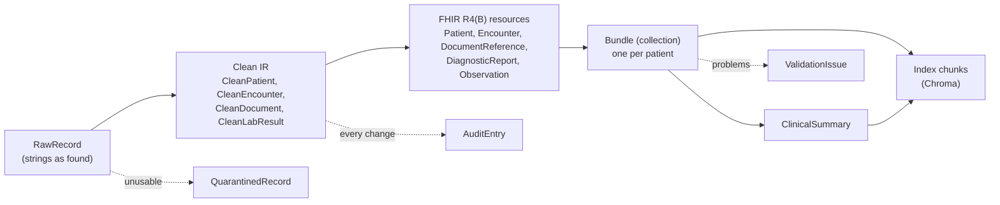
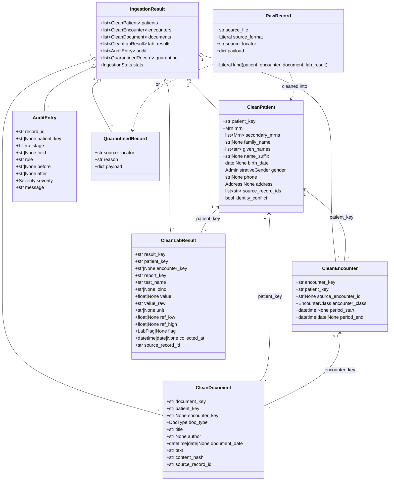
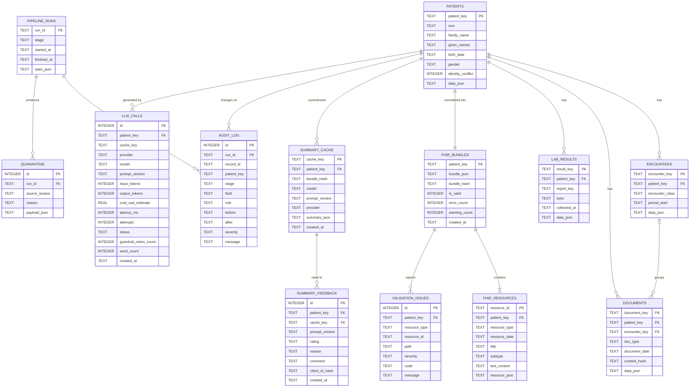
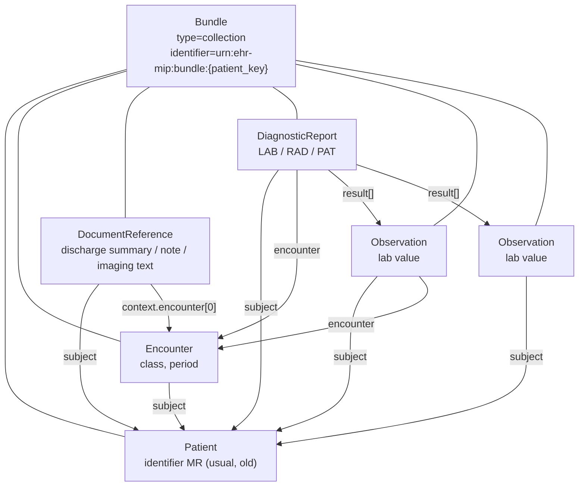
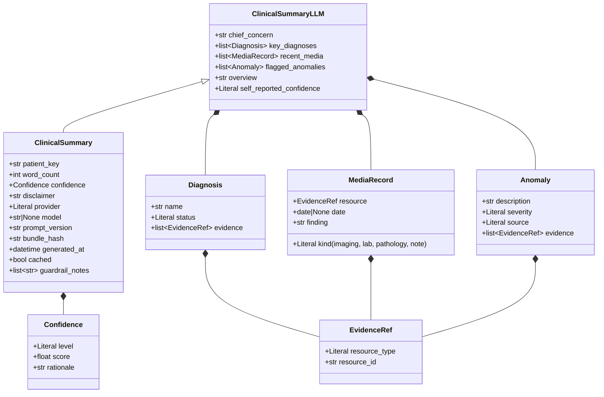

# 03. Data Model

Covers raw inputs, the clean intermediate representation (IR), SQLite schema, FHIR mapping, summary schema and the vector index. API payload schemas live in `04-API-CONTRACT.md`.

## 1. Model lifecycle



## 2. Raw input formats (synthetic)

### 2.1 `data/raw/ehr_export.json`
```json
{
  "export_id": "EPIC-EXP-2025-11",
  "generated_at": "2025-11-02T10:22:00Z",
  "patients": [{
    "mrn": "MRN-00012345",
    "name": "DOE, JANE A",
    "dob": "03/14/1968",
    "sex": "F",
    "phone": "(212) 555-0142",
    "address": {"line": "12 W 4th St", "city": "New York", "state": "NY", "zip": "10012"},
    "encounters": [{
      "encounter_id": "ENC-88231",
      "type": "inpatient",
      "start": "2025-02-01 08:30",
      "end": "2025-02-04",
      "documents": [{
        "doc_id": "DOC-1001",
        "doc_type": "Discharge Summary",
        "date": "Feb 4 2025",
        "author": "Dr. A. Rivera",
        "title": "Discharge Summary",
        "text": "HOSPITAL COURSE: ... ASSESSMENT: ... PLAN: ..."
      }]
    }]
  }]
}
```

### 2.2 `data/raw/lab_results.csv`
```
patient_mrn,patient_name,dob,collected_at,test_name,loinc,value,unit,ref_low,ref_high,flag,report_id,encounter_id
12345,"Jane Doe",1968-03-14,2025-02-02T06:10,Potassium,2823-3,5.9,mmol/L,3.5,5.1,H,LAB-5501,ENC-88231
12345,"Jane Doe",1968-03-14,2025-02-02T06:10,Creatinine,2160-0,2.1,mg/dL,0.6,1.1,,LAB-5501,ENC-88231
```

### 2.3 `data/raw/notes/*.txt`
```
PATIENT: Jane Doe        MRN: 0012345        DOB: 14-Mar-1968
DATE OF SERVICE: 2025/02/02     DOCUMENT: CT CHEST WITH CONTRAST
ENCOUNTER: ENC-88231
---
FINDINGS: ...
IMPRESSION: ...
```

### 2.4 `data/raw/_ground_truth.json` (tests and eval only)
```json
{
  "seed": 42,
  "patients": 60,
  "exact_duplicates": ["DOC-1001::notes/doe_ct_2025-02-02.txt"],
  "near_duplicates": [],
  "mrn_merges": [{"person_id": "S-007", "mrns": ["00012345", "00098765"]}],
  "mrn_conflicts": [{"mrn": "00055501", "dobs": ["1980-01-02", "1975-07-19"]}],
  "invalid_dates": [{"locator": "row 88", "value": "02/30/2024"}],
  "conditions": {"S-007": ["chronic kidney disease", "hyperkalemia"]}
}
```

## 3. Intermediate representation (Pydantic v2)



### 3.1 Enums and constrained types

```python
class AdministrativeGender(StrEnum): MALE="male"; FEMALE="female"; OTHER="other"; UNKNOWN="unknown"
class EncounterClass(StrEnum): INPATIENT="inpatient"; OUTPATIENT="outpatient"; EMERGENCY="emergency"; VIRTUAL="virtual"; UNKNOWN="unknown"
class DocType(StrEnum):
    DISCHARGE_SUMMARY="discharge_summary"; PROGRESS_NOTE="progress_note"; CONSULT_NOTE="consult_note"
    IMAGING_REPORT="imaging_report"; LAB_REPORT="lab_report"; PATHOLOGY_REPORT="pathology_report"
    SCANNED_DOCUMENT="scanned_document"
LabFlag = Literal["LL", "L", "N", "H", "HH"]
Severity = Literal["info", "warning", "error"]
Mrn = Annotated[str, StringConstraints(pattern=r"^\d{8}$")]
```

All models: `model_config = ConfigDict(extra="forbid", str_strip_whitespace=True, frozen=True)`, except `AuditEntry`, `RawRecord` and `QuarantinedRecord`, which keep whitespace so audit `before` values show exactly what was found.

`CleanEncounter.period_end` and date-only `CleanDocument.document_date` values keep their date precision (`date`); values with a time are timezone-aware `datetime` in `America/New_York`.

### 3.2 Key derivation (UUIDv5, namespace `ehr_mip.ids.NAMESPACE`)

| Key | Name string |
|---|---|
| `patient_key` | `patient:{canonical_mrn}` (split conflict patients: `patient:{mrn}:{dob}`) |
| `encounter_key` | `encounter:{patient_key}:{source_encounter_id}` |
| `document_key` | `document:{patient_key}:{content_hash}` |
| `report_key` (lab) | `report:{patient_key}:{source_report_id or collected_at}` |
| `result_key` | `result:{report_key}:{loinc or test_name}` |

FHIR `id` = the corresponding key, so resources, cache entries and vector ids stay stable across runs. The namespace and key helpers live in the shared `ehr_mip.ids` module (ingestion sits below fhir and cannot import it); `ehr_mip.fhir.ids` re-exports them.

## 4. SQLite schema

### 4.1 Entity relationship diagram



### 4.2 DDL (`backend/src/ehr_mip/db/schema.sql`)

```sql
PRAGMA journal_mode = WAL;
PRAGMA foreign_keys = ON;

CREATE TABLE IF NOT EXISTS pipeline_runs (
  run_id TEXT PRIMARY KEY, stage TEXT NOT NULL,
  started_at TEXT NOT NULL, finished_at TEXT, stats_json TEXT);

CREATE TABLE IF NOT EXISTS patients (
  patient_key TEXT PRIMARY KEY, mrn TEXT NOT NULL,
  family_name TEXT, given_names TEXT, birth_date TEXT, gender TEXT NOT NULL,
  identity_conflict INTEGER NOT NULL DEFAULT 0, data_json TEXT NOT NULL);
CREATE INDEX IF NOT EXISTS idx_patients_mrn ON patients(mrn);
CREATE INDEX IF NOT EXISTS idx_patients_name ON patients(family_name, given_names);

CREATE TABLE IF NOT EXISTS encounters (
  encounter_key TEXT PRIMARY KEY,
  patient_key TEXT NOT NULL REFERENCES patients(patient_key) ON DELETE CASCADE,
  encounter_class TEXT, period_start TEXT, data_json TEXT NOT NULL);

CREATE TABLE IF NOT EXISTS documents (
  document_key TEXT PRIMARY KEY,
  patient_key TEXT NOT NULL REFERENCES patients(patient_key) ON DELETE CASCADE,
  encounter_key TEXT REFERENCES encounters(encounter_key),
  doc_type TEXT NOT NULL, document_date TEXT, content_hash TEXT NOT NULL, data_json TEXT NOT NULL);
CREATE INDEX IF NOT EXISTS idx_documents_patient ON documents(patient_key, document_date);

CREATE TABLE IF NOT EXISTS lab_results (
  result_key TEXT PRIMARY KEY,
  patient_key TEXT NOT NULL REFERENCES patients(patient_key) ON DELETE CASCADE,
  report_key TEXT NOT NULL, loinc TEXT, collected_at TEXT, data_json TEXT NOT NULL);
CREATE INDEX IF NOT EXISTS idx_labs_patient ON lab_results(patient_key, collected_at);

CREATE TABLE IF NOT EXISTS audit_log (
  id INTEGER PRIMARY KEY AUTOINCREMENT,
  run_id TEXT REFERENCES pipeline_runs(run_id), record_id TEXT NOT NULL, patient_key TEXT,
  stage TEXT NOT NULL, field TEXT, rule TEXT NOT NULL, before TEXT, after TEXT,
  severity TEXT NOT NULL CHECK (severity IN ('info','warning','error')), message TEXT NOT NULL);
CREATE INDEX IF NOT EXISTS idx_audit_patient ON audit_log(patient_key);
CREATE INDEX IF NOT EXISTS idx_audit_rule ON audit_log(rule, severity);

CREATE TABLE IF NOT EXISTS quarantine (
  id INTEGER PRIMARY KEY AUTOINCREMENT, run_id TEXT REFERENCES pipeline_runs(run_id),
  source_locator TEXT NOT NULL, reason TEXT NOT NULL, payload_json TEXT NOT NULL);

CREATE TABLE IF NOT EXISTS fhir_bundles (
  patient_key TEXT PRIMARY KEY REFERENCES patients(patient_key) ON DELETE CASCADE,
  bundle_json TEXT NOT NULL, bundle_hash TEXT NOT NULL,
  is_valid INTEGER NOT NULL, error_count INTEGER NOT NULL DEFAULT 0,
  warning_count INTEGER NOT NULL DEFAULT 0, created_at TEXT NOT NULL);

CREATE TABLE IF NOT EXISTS fhir_resources (
  resource_id TEXT PRIMARY KEY,
  patient_key TEXT NOT NULL REFERENCES patients(patient_key) ON DELETE CASCADE,
  resource_type TEXT NOT NULL, resource_date TEXT, title TEXT, subtype TEXT,
  text_content TEXT, resource_json TEXT NOT NULL);
CREATE INDEX IF NOT EXISTS idx_res_patient ON fhir_resources(patient_key, resource_type, resource_date);

CREATE TABLE IF NOT EXISTS validation_issues (
  id INTEGER PRIMARY KEY AUTOINCREMENT,
  patient_key TEXT REFERENCES patients(patient_key) ON DELETE CASCADE,
  resource_type TEXT, resource_id TEXT, path TEXT,
  severity TEXT NOT NULL CHECK (severity IN ('info','warning','error')),
  code TEXT NOT NULL, message TEXT NOT NULL);
CREATE INDEX IF NOT EXISTS idx_vi_severity ON validation_issues(severity, code);

CREATE TABLE IF NOT EXISTS summary_cache (
  cache_key TEXT PRIMARY KEY,
  patient_key TEXT NOT NULL REFERENCES patients(patient_key) ON DELETE CASCADE,
  bundle_hash TEXT NOT NULL, model TEXT, prompt_version TEXT NOT NULL,
  provider TEXT NOT NULL, summary_json TEXT NOT NULL, created_at TEXT NOT NULL);
CREATE INDEX IF NOT EXISTS idx_summary_patient ON summary_cache(patient_key, created_at DESC);

-- AI telemetry: no prompt or output content, ids and numbers only
CREATE TABLE IF NOT EXISTS llm_calls (
  id INTEGER PRIMARY KEY AUTOINCREMENT,
  patient_key TEXT REFERENCES patients(patient_key) ON DELETE CASCADE,
  cache_key TEXT, provider TEXT NOT NULL, model TEXT, prompt_version TEXT NOT NULL,
  input_tokens INTEGER, output_tokens INTEGER, cost_usd_estimate REAL,
  latency_ms INTEGER NOT NULL, attempts INTEGER NOT NULL DEFAULT 1,
  status TEXT NOT NULL CHECK (status IN ('ok','retried','fallback','failed')),
  guardrail_notes_count INTEGER NOT NULL DEFAULT 0, word_count INTEGER, created_at TEXT NOT NULL);
CREATE INDEX IF NOT EXISTS idx_llm_calls_time ON llm_calls(created_at);

CREATE TABLE IF NOT EXISTS summary_feedback (
  id INTEGER PRIMARY KEY AUTOINCREMENT,
  patient_key TEXT NOT NULL REFERENCES patients(patient_key) ON DELETE CASCADE,
  cache_key TEXT NOT NULL REFERENCES summary_cache(cache_key) ON DELETE CASCADE,
  prompt_version TEXT NOT NULL,
  rating TEXT NOT NULL CHECK (rating IN ('helpful','not_helpful')),
  reason TEXT CHECK (reason IN ('inaccurate','missing_information','too_long','unclear','other')),
  comment TEXT CHECK (length(comment) <= 280),
  client_id_hash TEXT,           -- sha256 of an anonymous browser id, for one-vote-per-client
  created_at TEXT NOT NULL);
CREATE UNIQUE INDEX IF NOT EXISTS ux_feedback_client ON summary_feedback(cache_key, client_id_hash);
```

`fhir_resources.subtype` holds `doc_type` or DiagnosticReport category (`LAB`, `RAD`, `PAT`). `text_content` holds decoded text for detail views and the BM25 index.

## 5. FHIR mapping

### 5.1 Resource reference graph (inside one Bundle)



All references are `urn:uuid:{id}` and every `fullUrl` is `urn:uuid:{id}`.

### 5.2 Code systems used (`fhir/codes.py`)

| Purpose | System | Codes |
|---|---|---|
| MRN identifier type | `http://terminology.hl7.org/CodeSystem/v2-0203` | `MR` |
| MRN system (fictional) | `urn:oid:2.999.1.1` (ITU-T example arc, can never collide with a real system) | n/a |
| Document type | `http://loinc.org` | 18842-5 discharge summary, 11506-3 progress note, 11488-4 consult note, 18748-4 imaging study, 11502-2 lab report, 11526-1 pathology study, 34109-9 note |
| DocumentReference category | `http://hl7.org/fhir/us/core/CodeSystem/us-core-documentreference-category` | `clinical-note` |
| DiagnosticReport category | `http://terminology.hl7.org/CodeSystem/v2-0074` | `LAB`, `RAD`, `PAT` |
| Encounter class | `http://terminology.hl7.org/CodeSystem/v3-ActCode` | `IMP`, `AMB`, `EMER`, `VR` |
| Observation category | `http://terminology.hl7.org/CodeSystem/observation-category` | `laboratory` |
| Interpretation | `http://terminology.hl7.org/CodeSystem/v3-ObservationInterpretation` | `LL`, `L`, `N`, `H`, `HH` |
| Units | `http://unitsofmeasure.org` | UCUM where known |

### 5.3 Field mapping

**Patient**
| FHIR path | Source | Rule |
|---|---|---|
| `id` | `patient_key` | |
| `identifier[0]` | `mrn` | `use=usual`, type MR, MRN system |
| `identifier[1..]` | `secondary_mrns` | `use=old` |
| `name[0]` | family, given, name_suffix | `use=official`; `suffix` holds a generational suffix such as `Jr.` |
| `gender` | gender | AdministrativeGender |
| `birthDate` | birth_date | omit when None |
| `telecom[0]` | phone | `system=phone, use=home` (P1, built in Phase 6) |
| `address[0]` | address | P1, built in Phase 6 |
| `meta.tag[0]` | identity_conflict | `{system: urn:ehr-mip:tags, code: identity-conflict}` |

**Encounter**: `status=finished`, `class` ActCode (`v3-NullFlavor` `UNK` when the source type is unknown), `subject`, `period{start,end}`. Created only when a source encounter id exists.

**Which resource a document becomes.** Imaging and pathology documents become a DiagnosticReport (RAD or PAT) only, never also a DocumentReference, so search and summaries count each record once. Discharge summaries, progress notes, consult notes and scanned documents become DocumentReferences. Lab rows become one DiagnosticReport (LAB) per report with one Observation per result.

**Dates without a time.** FHIR `instant` fields (`DocumentReference.date`, `DiagnosticReport.issued`) need a time, so they are set only when the source has one; a date-only document date goes to `attachment.creation` (a `dateTime`) instead. No time is invented.

**DocumentReference**
| FHIR path | Value |
|---|---|
| `status` / `docStatus` | `current` / `final` |
| `type.coding[0]` | LOINC by doc_type |
| `category[0]` | `clinical-note` |
| `subject` | Patient |
| `date` | document_date as an instant with offset, only when the source has a time |
| `author[0].display` | author |
| `description` | title |
| `content[0].attachment` | `contentType="text/plain; charset=utf-8"`, `data`=base64 text, `title`, `creation` (document date, date or dateTime), `size`, `hash`=base64 SHA-1 |
| `context.encounter[0]` | Encounter (when known) |
| `context.period` | encounter period |

**DiagnosticReport**
| FHIR path | Value |
|---|---|
| `status` | `final` |
| `category[0]` | v2-0074 LAB, RAD or PAT |
| `code` | labs: panel LOINC when the report holds exactly that panel's defined tests (51990-0 BMP including calcium, 58410-2 CBC, 24331-1 lipid panel with calculated LDL; the test's own LOINC for a single-test report; otherwise 11502-2) + text. The synthetic seven-test chemistry set has no calcium, so it keeps 11502-2 with the title "Basic metabolic panel (without calcium)". Imaging 18748-4, pathology 11526-1, + the document title |
| `subject` / `encounter` | refs |
| `effectiveDateTime` / `issued` | collected or study date / report time (only when the source has a time) |
| `result[]` | Observations (labs) |
| `conclusion` | IMPRESSION text (imaging, pathology) or generated lab line ("2 abnormal: Potassium H, Creatinine H") |
| `presentedForm[0]` | text attachment (imaging, pathology) |

**Observation**: `status=final`, `category=laboratory`, `code` LOINC + text, `subject`, `encounter`, `effectiveDateTime`, `valueQuantity{value, unit, system=UCUM, code}` (with `comparator` for values such as `<0.01`) or `valueString` when not numeric, `referenceRange[0]{low, high}`, `interpretation[0]`.

## 6. Summary schema



Field limits: `chief_concern ≤ 160 chars`, `key_diagnoses ≤ 5` (name ≤ 80, `status ∈ active|historical|suspected`, evidence ≥ 1), `recent_media ≤ 5` (`kind ∈ imaging|lab|pathology|note`, finding ≤ 120), `flagged_anomalies ≤ 5` (description ≤ 140, `severity ∈ low|moderate|high`, `source ∈ rule|model`), `overview ≤ 600 chars`, total words ≤ 200.

`DISCLAIMER = "AI-generated summary for information retrieval only. Not a clinical decision. Verify against source records before acting."`

Cache key: `sha256(f"{patient_key}:{bundle_hash}:{prompt_version}:{model or 'extractive-2'}")`. The number is `EXTRACTIVE_RULES_VERSION`, raised when the extractive rules change their output.
`bundle_hash`: sha256 of canonical JSON (sorted keys, `timestamp` and `meta.lastUpdated` removed).

## 7. Vector index (Chroma collection `ehr_records`)

| Field | Content |
|---|---|
| `id` | `{resource_id}:{chunk_index}` (summary: `summary:{patient_key}:{chunk_index}`) |
| `embedding` | 384-dim, L2-normalized, all-MiniLM-L6-v2 |
| `document` | chunk text (no names, no MRNs) |
| `metadata.patient_key` | str |
| `metadata.resource_id` | str (summary: `summary:{patient_key}`) |
| `metadata.resource_type` | `DocumentReference` / `DiagnosticReport` / `Observation` / `ClinicalSummary` |
| `metadata.subtype` | doc_type or category |
| `metadata.title` | str |
| `metadata.date` | `YYYY-MM-DD` or `""`; for a summary, the date of the newest record it covers |
| `metadata.date_ord` | `date.toordinal()` or `0` (Chroma range operators need numbers) |
| `metadata.chunk_index` | int |

Space: cosine. Embeddings are computed by our `Embedder`, never by a Chroma default embedding function.
