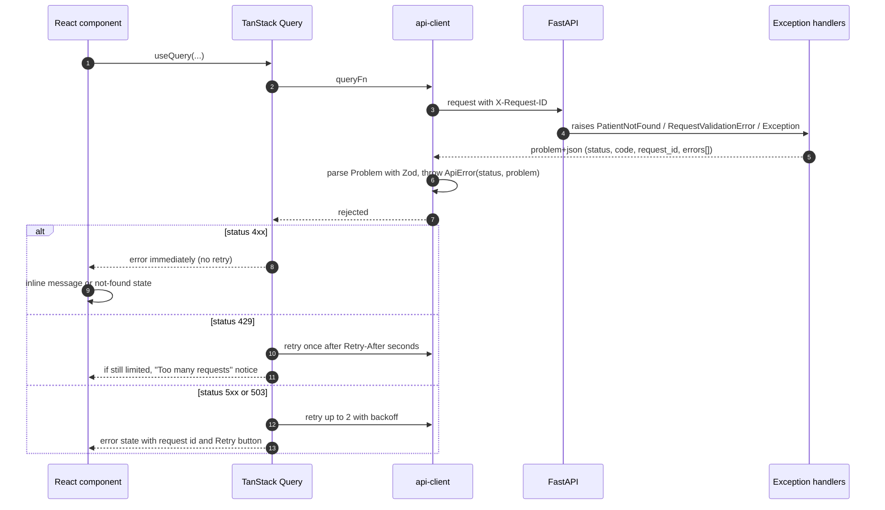
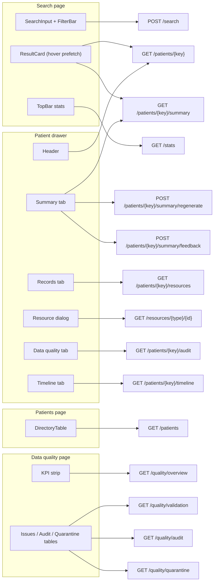

# 04. API Contract

The contract is the single source of truth between backend and frontend. Change this file first, then Pydantic (`backend/src/ehr_mip/api/schemas/`), then Zod (`frontend/src/features/*/schemas.ts`), then code. `tests/contract/test_openapi_snapshot.py` compares the generated OpenAPI with `docs/openapi.json` and fails on any undocumented change.

## 1. Conventions

| Item | Rule |
|---|---|
| Base URL (dev) | `http://localhost:8000` (browser calls `/api/*`, proxy strips `/api`) |
| Base URL (docker) | `http://localhost:8080/api` |
| Versioning | Unversioned paths (the brief names `POST /search`). Breaking changes require a new path and an ADR |
| Content type | `application/json; charset=utf-8`. FHIR payloads: `application/fhir+json`. Errors: `application/problem+json` |
| Naming | JSON fields `snake_case`. Enum values as listed below. Dates `YYYY-MM-DD`, datetimes ISO 8601 with offset |
| Ids | `patient_key`, `resource_id` are UUID strings (UUIDv5, stable) |
| Nulls | Optional fields are present with `null`, never omitted (predictable for Zod) |
| Auth | None (out of scope). Admin endpoints gated by `ENABLE_ADMIN_ENDPOINTS` |
| Limits | `/search` body ≤ 16 KB; `page_size ≤ 100`; `top_k ≤ 20` |
| CORS | Origins from `CORS_ORIGINS` |

### 1.1 Headers

| Header | Direction | Meaning |
|---|---|---|
| `X-Request-ID` | request (optional) / response (always) | Correlation id; generated if absent; included in logs and problem bodies |
| `Server-Timing` | response | `total;dur=..`, plus on `/search`: `embed;dur=..`, `vector;dur=..`, `lexical;dur=..`, `hydrate;dur=..` |
| `Cache-Control` | response | `no-store` for patient data; `max-age=5` for `/stats` |
| `ETag` | response on `/patients/{key}/summary` and `/bundle` | `"{bundle_hash}:{prompt_version}"`; `If-None-Match` returns 304 |
| `RateLimit-Limit`, `RateLimit-Remaining`, `RateLimit-Reset` | response | Current window state (limits in `09-SECURITY.md` §5.2) |
| `Retry-After` | response on 429 | Seconds until retry is allowed |
| `X-Cache` | response on `/search`, patient detail, resources | `HIT` or `MISS` from the server cache (`02-ARCHITECTURE.md` §8) |
| `X-Client-Id` | request (optional) | Anonymous random UUID from the browser, used only for one-vote-per-client feedback; stored hashed |
| Security headers | response | CSP, `X-Content-Type-Options`, `Referrer-Policy`, `Permissions-Policy`, COOP, CORP (`09-SECURITY.md` §5.1) |

## 2. Shared schemas

Notation: TypeScript-style. `?` is never used; nullable fields are `| null`. Pydantic class names in `PascalCase` match the Zod schema names with a `Schema` suffix (`SearchResponse` ↔ `SearchResponseSchema`).

### 2.1 Enums

```ts
type ResourceType       = "Patient" | "Encounter" | "DocumentReference" | "DiagnosticReport" | "Observation"
type SearchableType     = "DocumentReference" | "DiagnosticReport" | "Observation" | "ClinicalSummary"
type Gender             = "male" | "female" | "other" | "unknown"
type DocType            = "discharge_summary" | "progress_note" | "consult_note" | "imaging_report"
                        | "lab_report" | "pathology_report" | "scanned_document"
type ReportCategory     = "LAB" | "RAD" | "PAT"
type Severity           = "info" | "warning" | "error"
type AnomalySeverity    = "low" | "moderate" | "high"
type ConfidenceLevel    = "low" | "medium" | "high"
type SearchMode         = "semantic" | "hybrid"
type MatchType          = "semantic" | "lexical" | "hybrid" | "mrn"
type SummaryProvider    = "anthropic" | "extractive"
type PipelineStage      = "ingest" | "normalize" | "summarize" | "index"
type RunStatus          = "queued" | "running" | "succeeded" | "failed"
```

### 2.2 Common objects

```ts
interface PatientRef {               // compact patient, used in lists and search results
  patient_key: string
  display_name: string               // "Jane A. Doe" or "Unknown patient"
  mrn: string                        // canonical 8 digits
  birth_date: string | null          // YYYY-MM-DD
  age: number | null                 // years at today
  gender: Gender
  identity_conflict: boolean
}

interface ResourceRef {              // compact resource, used in lists and search results
  resource_type: SearchableType | "Encounter"
  resource_id: string                // for ClinicalSummary: "summary:{patient_key}"
  date: string | null                // YYYY-MM-DD
  title: string
  subtype: DocType | ReportCategory | null
  is_valid: boolean                  // false if its bundle has errors on this resource
}

interface EvidenceRef { resource_type: "DocumentReference" | "DiagnosticReport" | "Observation" | "Encounter"; resource_id: string }

interface Page<T> { items: T[]; page: number; page_size: number; total: number; total_pages: number }
```

### 2.3 Error model (RFC 9457)

```ts
interface Problem {
  type: string          // "https://ehr-mip.local/problems/{code}"
  title: string         // short, human
  status: number
  detail: string        // specific explanation
  instance: string      // request path
  code: ErrorCode
  request_id: string
  errors: FieldError[]  // empty unless 422
}
interface FieldError { loc: string; message: string; type: string }   // loc like "query.date_to" or "body.query"
```

Example 422:
```json
{
  "type": "https://ehr-mip.local/problems/validation_error",
  "title": "Request validation failed",
  "status": 422,
  "detail": "date_to must be on or after date_from",
  "instance": "/search",
  "code": "validation_error",
  "request_id": "6f1c2b0e-9d7a-4c55-8a51-0f2b1d9e3c11",
  "errors": [{"loc": "query.date_to", "message": "date_to must be on or after date_from", "type": "value_error"}]
}
```

### 2.4 Error code catalog

| `code` | HTTP | When | Frontend behavior |
|---|---|---|---|
| `validation_error` | 422 | Bad query, body or path params | Inline field message; do not retry |
| `not_found` | 404 | Unknown route | Generic error state |
| `method_not_allowed` | 405 | Known route, wrong HTTP method | Generic error state |
| `patient_not_found` | 404 | Unknown `patient_key` | Drawer shows "Patient not found", clears `?patient` |
| `resource_not_found` | 404 | Unknown resource | Dialog error |
| `summary_not_found` | 404 | Summary not generated yet | Summary tab: "Summary not generated. Run the pipeline." |
| `search_index_empty` | 503 | Nothing indexed | Info alert with `make pipeline` hint |
| `not_ready` | 503 | Embedder or store not loaded | Retry with backoff (TanStack Query retry 2) |
| `llm_unavailable` | 502 | Regenerate failed and fallback disabled | Toast with retry |
| `conflict_run_in_progress` | 409 | Pipeline already running | Show current run |
| `admin_disabled` | 403 | Admin endpoint with flag off | Hide admin UI |
| `payload_too_large` | 413 | Body over limit | Inline message |
| `rate_limited` | 429 | Rate limit exceeded | Wait `Retry-After`, show "Too many requests, retrying in Ns"; TanStack retry honors it |
| `llm_budget_exceeded` | 429 | Daily token budget used | Regenerate disabled with tooltip; cached summaries still shown |
| `admin_unauthorized` | 401 | Missing or wrong `X-Admin-Token` | Hide admin UI |
| `feedback_duplicate` | 409 | Same client already rated this summary version | Show existing vote |
| `internal_error` | 500 | Unhandled | Error state with request id |

## 3. Endpoint index

| # | Method | Path | Purpose | Tier |
|---|---|---|---|---|
| 1 | GET | `/health` | Liveness | R |
| 2 | GET | `/ready` | Readiness and component checks | R |
| 3 | GET | `/stats` | Counts for header | P1 |
| 4 | POST | `/search` | Semantic search, top 5 | **R (brief)** |
| 5 | GET | `/patients` | Paginated directory | P1 |
| 6 | GET | `/patients/{patient_key}` | Patient detail for drawer header | R |
| 7 | GET | `/patients/{patient_key}/resources` | Linked FHIR resources for drawer table | R |
| 8 | GET | `/patients/{patient_key}/summary` | Latest AI summary | R |
| 9 | POST | `/patients/{patient_key}/summary/regenerate` | Bypass cache | P2 |
| 10 | GET | `/patients/{patient_key}/bundle` | FHIR Bundle JSON | P2 |
| 11 | GET | `/patients/{patient_key}/timeline` | Chronological events | P2 |
| 12 | GET | `/patients/{patient_key}/audit` | Audit entries for patient | P1 |
| 13 | GET | `/resources/{resource_type}/{resource_id}` | One resource, decoded text + FHIR JSON | R |
| 14 | GET | `/quality/overview` | Ingestion, validation, summary KPIs | P1 |
| 15 | GET | `/quality/validation` | Validation issues | P1 |
| 16 | GET | `/quality/audit` | Audit log | P1 |
| 17 | GET | `/quality/quarantine` | Quarantined records | P1 |
| 18 | POST | `/pipeline/runs` | Trigger pipeline (admin) | P2 |
| 19 | GET | `/pipeline/runs/{run_id}` | Run status (admin) | P2 |
| 20 | POST | `/patients/{patient_key}/summary/feedback` | Rate a summary | P1 |
| 21 | GET | `/metrics` | Prometheus metrics (text format) | P1 |

---

## 4. System

### 4.1 `GET /health`
Liveness only, no dependencies touched.

Response `200`:
```json
{ "status": "ok", "version": "0.1.0" }
```

### 4.2 `GET /ready`
Checks every component. Returns `200` when sqlite, vector store and embedder pass, otherwise `503`. Both cases return the body below (not a problem+json) so the UI and Docker health checks can show which component failed.

```ts
interface ReadyResponse {
  status: "ready" | "degraded" | "not_ready"
  checks: {
    sqlite:       { ok: boolean; detail: string }
    vector_store: { ok: boolean; detail: string; chunks: number }
    embedder:     { ok: boolean; detail: string; model: string }
    llm:          { ok: boolean; detail: string; provider: SummaryProvider; model: string | null }
  }
  counts: { patients: number; resources: number; summaries: number; chunks: number }
  last_run: { run_id: string; finished_at: string | null; status: RunStatus } | null
  flags: { search_mode: SearchMode; index_observations: boolean; admin_enabled: boolean;
           cache_backend: "memory" | "redis"; feedback_enabled: boolean }
  cache: { backend: "memory" | "redis"; ok: boolean; index_version: number }
}
```
`degraded` = API usable but LLM provider is extractive, vector store empty, or Redis configured but unreachable (the API then falls back to the memory cache).

Example:
```json
{
  "status": "ready",
  "checks": {
    "sqlite": {"ok": true, "detail": "wal"},
    "vector_store": {"ok": true, "detail": "collection ehr_records", "chunks": 1184},
    "embedder": {"ok": true, "detail": "warm", "model": "sentence-transformers/all-MiniLM-L6-v2"},
    "llm": {"ok": true, "detail": "api key present", "provider": "anthropic", "model": "claude-haiku-5-5"}
  },
  "counts": {"patients": 60, "resources": 612, "summaries": 60, "chunks": 1184},
  "last_run": {"run_id": "run_2025-11-20T13-02-11Z", "finished_at": "2025-11-20T13:04:40Z", "status": "succeeded"},
  "flags": {"search_mode": "hybrid", "index_observations": false, "admin_enabled": false, "cache_backend": "memory", "feedback_enabled": true},
  "cache": {"backend": "memory", "ok": true, "index_version": 3}
}
```

### 4.3 `GET /stats`
```ts
interface StatsResponse {
  patients: number
  resources_by_type: Record<"Encounter" | "DocumentReference" | "DiagnosticReport" | "Observation", number>
  searchable_records: number
  summaries: number
  last_pipeline_run_at: string | null
}
```
Example: `{"patients":60,"resources_by_type":{"Encounter":88,"DocumentReference":171,"DiagnosticReport":79,"Observation":214},"searchable_records":310,"summaries":60,"last_pipeline_run_at":"2025-11-20T13:04:40Z"}`

---

## 5. Search

### 5.1 `POST /search`

Free text search across FHIR document text and AI summaries. Returns the top `top_k` (default 5) records, one result per resource, sorted by `score` descending.

**Query parameters**

| Name | Type | Default | Rules |
|---|---|---|---|
| `resource_type` | `SearchableType`, repeatable | all | Unknown value → 422. Example `?resource_type=DocumentReference&resource_type=DiagnosticReport` |
| `date_from` | `YYYY-MM-DD` | none | Inclusive. Records without a date are excluded when any date filter is set |
| `date_to` | `YYYY-MM-DD` | none | Inclusive. Must be ≥ `date_from` |
| `top_k` | int | 5 | 1 to 20 |
| `mode` | `SearchMode` | `SEARCH_MODE` setting | |
| `patient_key` | UUID | none | Restrict to one patient (used by drawer "search within patient", P2) |

**Request body**
```ts
interface SearchRequest { query: string }   // trimmed; 2..500 chars after trim
```

**Response `200`**
```ts
interface SearchResponse {
  query: string
  took_ms: number
  total: number                 // results.length
  mode: SearchMode
  filters: { resource_type: SearchableType[]; date_from: string | null; date_to: string | null; patient_key: string | null }
  results: SearchResult[]
}
interface SearchResult {
  rank: number                  // 1-based
  score: number                 // 0..1, 4 decimals, display value
  semantic_score: number        // 0..1, raw cosine similarity of best chunk
  match_type: MatchType
  patient: PatientRef
  resource: ResourceRef
  snippet: string               // best chunk, ≤ 320 chars, ellipsized at word boundary
  highlights: [number, number][]// char ranges in snippet matching query terms (for <mark>)
  summary_snippet: string | null// chief concern from latest summary, ≤ 160 chars
}
```

**Example request**
```bash
curl -s -X POST 'http://localhost:8000/search?resource_type=DiagnosticReport&date_from=2024-06-01' \
  -H 'Content-Type: application/json' \
  -d '{"query": "worsening kidney function with high potassium"}'
```

**Example response**
```json
{
  "query": "worsening kidney function with high potassium",
  "took_ms": 41,
  "total": 2,
  "mode": "hybrid",
  "filters": {"resource_type": ["DiagnosticReport"], "date_from": "2024-06-01", "date_to": null, "patient_key": null},
  "results": [
    {
      "rank": 1,
      "score": 0.8123,
      "semantic_score": 0.7342,
      "match_type": "hybrid",
      "patient": {"patient_key": "3b7f9c2e-5a41-5d0e-9b8a-1f2c3d4e5f60", "display_name": "Jane A. Doe", "mrn": "00012345",
                  "birth_date": "1968-03-14", "age": 57, "gender": "female", "identity_conflict": false},
      "resource": {"resource_type": "DiagnosticReport", "resource_id": "9a1e0c44-2d3b-5f6a-8c7d-0e1f2a3b4c5d", "date": "2025-02-02",
                   "title": "Basic metabolic panel", "subtype": "LAB", "is_valid": true},
      "snippet": "Lab report: Basic metabolic panel. 2025-02-02. Results: Potassium 5.9 mmol/L (H); Creatinine 2.1 mg/dL (H); Sodium 138 mmol/L (N)",
      "highlights": [[57, 66], [90, 100]],
      "summary_snippet": "Acute kidney injury on CKD stage 3 with hyperkalemia."
    },
    {
      "rank": 2,
      "score": 0.6610,
      "semantic_score": 0.6610,
      "match_type": "semantic",
      "patient": {"patient_key": "c0ffee00-1111-5222-8333-444455556666", "display_name": "Marcus T. Hale", "mrn": "00044120",
                  "birth_date": "1952-11-02", "age": 73, "gender": "male", "identity_conflict": false},
      "resource": {"resource_type": "DiagnosticReport", "resource_id": "1d2c3b4a-5e6f-5a7b-8c9d-0a1b2c3d4e5f", "date": "2024-09-18",
                   "title": "Renal function panel", "subtype": "LAB", "is_valid": true},
      "snippet": "Lab report: Renal function panel. 2024-09-18. Results: Creatinine 1.9 mg/dL (H); eGFR 34 mL/min (L); Potassium 5.4 mmol/L (H)",
      "highlights": [[72, 81]],
      "summary_snippet": "Follow-up of CKD stage 3b; rising creatinine over 6 months."
    }
  ]
}
```

**Errors**

| Status | code | Trigger |
|---|---|---|
| 422 | `validation_error` | query shorter than 2 or longer than 500 chars; bad enum; bad date; `date_to < date_from`; `top_k` out of range |
| 413 | `payload_too_large` | body over 16 KB |
| 503 | `search_index_empty` | collection has 0 chunks |
| 503 | `not_ready` | embedder not loaded |

**Behavioral guarantees**: results sorted by `score` desc, ties broken by newer `date`; `total ≤ top_k`; no two results share a `resource_id`; an empty `results` array with `200` when nothing matches.

---

## 6. Patients

### 6.1 `GET /patients`

| Query | Type | Default | Rules |
|---|---|---|---|
| `q` | string | none | Matches name (case-insensitive contains) or MRN (digits, prefix) |
| `page` | int | 1 | ≥ 1 |
| `page_size` | int | 25 | 1..100 |
| `sort` | `name \| mrn \| birth_date \| last_activity \| resource_count` | `last_activity` | |
| `order` | `asc \| desc` | `desc` | |
| `conflict_only` | bool | false | Only `identity_conflict = true` |

Response `200`: `Page<PatientListItem>`
```ts
interface PatientListItem extends PatientRef {
  last_activity: string | null      // newest resource date
  resource_count: number
  has_summary: boolean
  chief_concern: string | null
  anomaly_counts: { high: number; moderate: number; low: number }
}
```
Example:
```json
{
  "items": [{
    "patient_key": "3b7f9c2e-5a41-5d0e-9b8a-1f2c3d4e5f60", "display_name": "Jane A. Doe", "mrn": "00012345",
    "birth_date": "1968-03-14", "age": 57, "gender": "female", "identity_conflict": false,
    "last_activity": "2025-02-04", "resource_count": 12, "has_summary": true,
    "chief_concern": "Acute kidney injury on CKD stage 3 with hyperkalemia.",
    "anomaly_counts": {"high": 1, "moderate": 2, "low": 1}
  }],
  "page": 1, "page_size": 25, "total": 60, "total_pages": 3
}
```
Errors: 422 on bad params.

### 6.2 `GET /patients/{patient_key}`

```ts
interface PatientDetail extends PatientRef {
  family_name: string | null
  given_names: string[]
  identifiers: { system: string; value: string; use: "usual" | "old" }[]
  phone: string | null
  address: { line: string | null; city: string | null; state: string | null; postal_code: string | null } | null
  bundle: { is_valid: boolean; error_count: number; warning_count: number; bundle_hash: string }
  counts: Record<"Encounter" | "DocumentReference" | "DiagnosticReport" | "Observation", number>
  first_activity: string | null
  last_activity: string | null
  data_quality: { audit_entries: number; warnings: number; errors: number }
}
```
Example:
```json
{
  "patient_key": "3b7f9c2e-5a41-5d0e-9b8a-1f2c3d4e5f60", "display_name": "Jane A. Doe", "mrn": "00012345",
  "birth_date": "1968-03-14", "age": 57, "gender": "female", "identity_conflict": false,
  "family_name": "Doe", "given_names": ["Jane", "A"],
  "identifiers": [
    {"system": "urn:oid:2.999.1.1", "value": "00012345", "use": "usual"},
    {"system": "urn:oid:2.999.1.1", "value": "00098765", "use": "old"}
  ],
  "phone": "+12125550142",
  "address": {"line": "12 W 4th St", "city": "New York", "state": "NY", "postal_code": "10012"},
  "bundle": {"is_valid": true, "error_count": 0, "warning_count": 1, "bundle_hash": "b1946ac92492d2347c6235b4d2611184"},
  "counts": {"Encounter": 2, "DocumentReference": 4, "DiagnosticReport": 3, "Observation": 9},
  "first_activity": "2024-08-11", "last_activity": "2025-02-04",
  "data_quality": {"audit_entries": 14, "warnings": 2, "errors": 0}
}
```
Errors: 404 `patient_not_found`, 422 when `patient_key` is not a UUID.

### 6.3 `GET /patients/{patient_key}/resources`

| Query | Type | Default |
|---|---|---|
| `resource_type` | `ResourceType`, repeatable | all except Patient |
| `sort` | `date \| type \| title` | `date` |
| `order` | `asc \| desc` | `desc` |

Not paginated (a patient has at most a few dozen resources).

```ts
interface PatientResourcesResponse { patient_key: string; total: number; items: PatientResourceItem[] }
interface PatientResourceItem extends ResourceRef {
  status: string                       // FHIR status (final, current, finished)
  encounter_id: string | null
  summary_line: string | null          // conclusion, description, or "Potassium 5.9 mmol/L (H)"
  interpretation: "LL" | "L" | "N" | "H" | "HH" | null   // Observations only
  issues: { severity: Severity; code: string; message: string }[]
}
```
Example:
```json
{
  "patient_key": "3b7f9c2e-5a41-5d0e-9b8a-1f2c3d4e5f60",
  "total": 2,
  "items": [
    {"resource_type": "DocumentReference", "resource_id": "0b8d…", "date": "2025-02-04", "title": "Discharge Summary",
     "subtype": "discharge_summary", "is_valid": true, "status": "current", "encounter_id": "7e21…",
     "summary_line": "Discharge Summary", "interpretation": null, "issues": []},
    {"resource_type": "Observation", "resource_id": "5c3a…", "date": "2025-02-02", "title": "Potassium",
     "subtype": null, "is_valid": true, "status": "final", "encounter_id": "7e21…",
     "summary_line": "Potassium 5.9 mmol/L (H, ref 3.5 to 5.1)", "interpretation": "H", "issues": []}
  ]
}
```
Errors: 404 `patient_not_found`, 422.

### 6.4 `GET /patients/{patient_key}/summary`

Returns the latest cached summary for the current bundle hash. Supports `If-None-Match`.

```ts
interface ClinicalSummaryResponse {
  patient_key: string
  chief_concern: string
  key_diagnoses: { name: string; status: "active" | "historical" | "suspected"; evidence: EvidenceRef[] }[]
  recent_media: { resource: EvidenceRef; kind: "imaging" | "lab" | "pathology" | "note"; date: string | null; finding: string }[]
  flagged_anomalies: { description: string; severity: AnomalySeverity; source: "rule" | "model"; evidence: EvidenceRef[] }[]
  overview: string
  word_count: number                   // ≤ 200
  confidence: { level: ConfidenceLevel; score: number; rationale: string }
  disclaimer: string
  provider: SummaryProvider
  model: string | null
  prompt_version: string
  bundle_hash: string
  generated_at: string
  cached: boolean
  cache_key: string
  guardrail_notes: string[]
}
```
Example:
```json
{
  "patient_key": "3b7f9c2e-5a41-5d0e-9b8a-1f2c3d4e5f60",
  "chief_concern": "Admitted for acute kidney injury on CKD stage 3 with hyperkalemia.",
  "key_diagnoses": [
    {"name": "Chronic kidney disease stage 3", "status": "active",
     "evidence": [{"resource_type": "DocumentReference", "resource_id": "0b8d…"}]},
    {"name": "Hyperkalemia", "status": "active",
     "evidence": [{"resource_type": "Observation", "resource_id": "5c3a…"}]}
  ],
  "recent_media": [
    {"resource": {"resource_type": "DiagnosticReport", "resource_id": "9a1e…"}, "kind": "lab", "date": "2025-02-02",
     "finding": "K 5.9 H, creatinine 2.1 H"},
    {"resource": {"resource_type": "DiagnosticReport", "resource_id": "44f0…"}, "kind": "imaging", "date": "2025-02-02",
     "finding": "CT chest: no acute process"}
  ],
  "flagged_anomalies": [
    {"description": "Potassium 5.9 mmol/L above reference range", "severity": "high", "source": "rule",
     "evidence": [{"resource_type": "Observation", "resource_id": "5c3a…"}]},
    {"description": "Record merged from two MRNs", "severity": "low", "source": "rule", "evidence": []}
  ],
  "overview": "57-year-old female with CKD 3 admitted with AKI and hyperkalemia; creatinine up from 1.4 to 2.1. Discharged after 3 days.",
  "word_count": 96,
  "confidence": {"level": "medium", "score": 0.65, "rationale": "Records consistent; identity merge lowers certainty."},
  "disclaimer": "AI-generated summary for information retrieval only. Not a clinical decision. Verify against source records before acting.",
  "provider": "anthropic",
  "model": "claude-haiku-5-5",
  "prompt_version": "v1",
  "bundle_hash": "b1946ac92492d2347c6235b4d2611184",
  "generated_at": "2025-11-20T13:03:52Z",
  "cached": true,
  "cache_key": "4f1d2a9b0c7e",
  "guardrail_notes": []
}
```
Errors: 404 `patient_not_found`, 404 `summary_not_found`, 304 when ETag matches.

### 6.5 `POST /patients/{patient_key}/summary/regenerate` (P2)

Body: none (or `{}`). Runs the summary service with `force=true` synchronously (timeout 45 s).
Response `200`: `ClinicalSummaryResponse` with `cached: false`.
Errors: 404 `patient_not_found`; 502 `llm_unavailable` only if fallback is disabled; 409 `conflict_run_in_progress` if the same patient is already regenerating; 429 if more than 5 regenerations per minute (simple in-memory limiter).

### 6.6 `GET /patients/{patient_key}/bundle` (P2)

Response `200`, `Content-Type: application/fhir+json`, `Content-Disposition: attachment; filename="bundle-{mrn}.json"`. Body is the stored FHIR Bundle exactly:
```json
{
  "resourceType": "Bundle",
  "id": "3b7f9c2e-5a41-5d0e-9b8a-1f2c3d4e5f60",
  "identifier": {"system": "urn:ehr-mip:bundle", "value": "3b7f9c2e-5a41-5d0e-9b8a-1f2c3d4e5f60"},
  "type": "collection",
  "timestamp": "2025-11-20T13:02:40+00:00",
  "entry": [
    {"fullUrl": "urn:uuid:3b7f9c2e-5a41-5d0e-9b8a-1f2c3d4e5f60",
     "resource": {"resourceType": "Patient", "id": "3b7f9c2e-5a41-5d0e-9b8a-1f2c3d4e5f60", "gender": "female", "birthDate": "1968-03-14",
                  "identifier": [{"use": "usual", "system": "urn:oid:2.999.1.1", "value": "00012345",
                                  "type": {"coding": [{"system": "http://terminology.hl7.org/CodeSystem/v2-0203", "code": "MR"}]}}],
                  "name": [{"use": "official", "family": "Doe", "given": ["Jane", "A"]}]}},
    {"fullUrl": "urn:uuid:9a1e0c44-2d3b-5f6a-8c7d-0e1f2a3b4c5d",
     "resource": {"resourceType": "DiagnosticReport", "id": "9a1e0c44-2d3b-5f6a-8c7d-0e1f2a3b4c5d", "status": "final",
                  "category": [{"coding": [{"system": "http://terminology.hl7.org/CodeSystem/v2-0074", "code": "LAB"}]}],
                  "code": {"coding": [{"system": "http://loinc.org", "code": "51990-0"}], "text": "Basic metabolic panel"},
                  "subject": {"reference": "urn:uuid:3b7f9c2e-5a41-5d0e-9b8a-1f2c3d4e5f60"},
                  "encounter": {"reference": "urn:uuid:7e21…"},
                  "effectiveDateTime": "2025-02-02T06:10:00-05:00",
                  "result": [{"reference": "urn:uuid:5c3a…"}],
                  "conclusion": "2 abnormal: Potassium H, Creatinine H"}}
  ]
}
```
Errors: 404 `patient_not_found`; 304 on ETag match.

### 6.7 `GET /patients/{patient_key}/timeline` (P2)

```ts
interface TimelineResponse {
  patient_key: string
  groups: { month: string; events: TimelineEvent[] }[]     // month "2025-02", newest first
}
interface TimelineEvent {
  date: string
  resource: ResourceRef
  label: string                       // "Admitted (inpatient)", "CT chest with contrast", "BMP: 2 abnormal"
  severity: AnomalySeverity | null    // highest anomaly linked to this resource
}
```
Errors: 404 `patient_not_found`.

### 6.8 `GET /patients/{patient_key}/audit` (P1)

| Query | Type | Default |
|---|---|---|
| `severity` | `Severity`, repeatable | all |
| `page`, `page_size` | int | 1, 50 |

Response `200`: `Page<AuditEntryItem>`
```ts
interface AuditEntryItem {
  id: number
  run_id: string
  record_id: string
  stage: "read" | "clean" | "identity" | "dedupe"
  field: string | null
  rule: string                // e.g. "date.parse.us_ambiguous"
  before: string | null       // PHI fields (name, DOB, phone) are masked: "J*** D**", "19**-**-14"
  after: string | null
  severity: Severity
  message: string
}
```
Example item: `{"id":118,"run_id":"run_2025-11-20T13-02-11Z","record_id":"ehr_export.json:patients[3]","stage":"clean","field":"gender","rule":"gender.map","before":"F","after":"female","severity":"info","message":"Mapped source code F to FHIR female"}`

---

## 7. Resources

### 7.1 `GET /resources/{resource_type}/{resource_id}`

`resource_type ∈ Encounter | DocumentReference | DiagnosticReport | Observation`.

```ts
interface ResourceDetail {
  resource: ResourceRef
  patient: PatientRef
  text: string | null                // decoded attachment / presentedForm / conclusion, for reading
  sections: { heading: string; body: string }[]   // parsed "FINDINGS:", "IMPRESSION:" etc. when present
  observations: { resource_id: string; name: string; value: string; unit: string | null;
                  interpretation: "LL" | "L" | "N" | "H" | "HH" | null;
                  reference_range: string | null }[]   // DiagnosticReport LAB only
  issues: { severity: Severity; code: string; message: string; path: string }[]
  fhir: Record<string, unknown>      // raw FHIR JSON of this resource
}
```
Example (truncated):
```json
{
  "resource": {"resource_type": "DocumentReference", "resource_id": "44f0…", "date": "2025-02-02",
               "title": "CT chest with contrast", "subtype": "imaging_report", "is_valid": true},
  "patient": {"patient_key": "3b7f…", "display_name": "Jane A. Doe", "mrn": "00012345", "birth_date": "1968-03-14",
              "age": 57, "gender": "female", "identity_conflict": false},
  "text": "FINDINGS: Lungs are clear...\nIMPRESSION: No acute cardiopulmonary process.",
  "sections": [{"heading": "FINDINGS", "body": "Lungs are clear..."}, {"heading": "IMPRESSION", "body": "No acute cardiopulmonary process."}],
  "observations": [],
  "issues": [],
  "fhir": {"resourceType": "DocumentReference", "id": "44f0…", "status": "current"}
}
```
Errors: 404 `resource_not_found`; 422 on unknown `resource_type`.

---

## 8. Data quality (P1)

### 8.1 `GET /quality/overview`

```ts
interface QualityOverview {
  ingestion: {
    records_read: number; by_format: { json: number; csv: number; txt: number }
    patients: number; documents: number; lab_results: number
    exact_duplicates_removed: number; near_duplicates_removed: number
    identities_merged: number; identity_conflicts: number
    quarantined: number
    audit_by_severity: { info: number; warning: number; error: number }
    top_rules: { rule: string; count: number }[]          // top 8
  }
  validation: {
    bundles: number; valid_bundles: number
    issues_by_severity: { info: number; warning: number; error: number }
    top_codes: { code: string; count: number }[]
  }
  summaries: {
    total: number; by_provider: { anthropic: number; extractive: number }
    avg_word_count: number; max_word_count: number
    confidence: { low: number; medium: number; high: number }
    guardrail_interventions: number
    llm: { calls: number; fallback_calls: number; failed_calls: number;
           input_tokens: number; output_tokens: number; cost_usd_estimate: number; p95_latency_ms: number }
    feedback: { helpful: number; not_helpful: number; helpful_rate: number | null;
                by_prompt_version: { prompt_version: string; helpful_rate: number | null; votes: number }[] }
  }
  last_run: { run_id: string; finished_at: string | null; status: RunStatus } | null
}
```
Example:
```json
{
  "ingestion": {"records_read": 412, "by_format": {"json": 231, "csv": 129, "txt": 52}, "patients": 60, "documents": 171,
    "lab_results": 214, "exact_duplicates_removed": 12, "near_duplicates_removed": 6, "identities_merged": 3,
    "identity_conflicts": 2, "quarantined": 4, "audit_by_severity": {"info": 640, "warning": 37, "error": 9},
    "top_rules": [{"rule": "date.parse.format", "count": 301}, {"rule": "mrn.normalize", "count": 188}]},
  "validation": {"bundles": 60, "valid_bundles": 60, "issues_by_severity": {"info": 7, "warning": 2, "error": 0},
    "top_codes": [{"code": "patient.birthdate_missing", "count": 5}]},
  "summaries": {"total": 60, "by_provider": {"anthropic": 60, "extractive": 0}, "avg_word_count": 128,
    "max_word_count": 187, "confidence": {"low": 6, "medium": 31, "high": 23}, "guardrail_interventions": 4,
    "llm": {"calls": 61, "fallback_calls": 0, "failed_calls": 0, "input_tokens": 98210, "output_tokens": 14630,
            "cost_usd_estimate": 0.17, "p95_latency_ms": 3120},
    "feedback": {"helpful": 9, "not_helpful": 1, "helpful_rate": 0.9,
                 "by_prompt_version": [{"prompt_version": "v1", "helpful_rate": 0.9, "votes": 10}]}},
  "last_run": {"run_id": "run_2025-11-20T13-02-11Z", "finished_at": "2025-11-20T13:04:40Z", "status": "succeeded"}
}
```

### 8.2 `GET /quality/validation`

| Query | Type | Default |
|---|---|---|
| `severity` | `Severity`, repeatable | all |
| `resource_type` | `ResourceType`, repeatable | all |
| `code` | string | none |
| `page`, `page_size` | int | 1, 50 |

Response `200`: `Page<ValidationIssueItem>`
```ts
interface ValidationIssueItem {
  id: number
  patient: PatientRef
  resource_type: ResourceType | "Bundle"
  resource_id: string | null
  path: string                       // "DocumentReference.content[0].attachment.contentType"
  severity: Severity
  code: string                       // "schema.invalid", "ref.unresolved", "patient.birthdate_missing" …
  message: string
}
```

### 8.3 `GET /quality/audit`

| Query | Type | Default |
|---|---|---|
| `rule` | string (prefix match, e.g. `date.`) | none |
| `stage` | `read \| clean \| identity \| dedupe`, repeatable | all |
| `severity` | `Severity`, repeatable | all |
| `patient_key` | UUID | none |
| `page`, `page_size` | int | 1, 50 |

Response `200`: `Page<AuditEntryItem & { patient: PatientRef | null }>`.

### 8.4 `GET /quality/quarantine`

Response `200`: `Page<QuarantineItem>`
```ts
interface QuarantineItem { id: number; run_id: string; source_locator: string; reason: string; payload_preview: string }  // preview masked, ≤ 200 chars
```

---

## 9. Pipeline admin (P2, `ENABLE_ADMIN_ENDPOINTS=true` only)

Both endpoints require header `X-Admin-Token: <ADMIN_TOKEN>` (compared in constant time). Missing or wrong token → 401 `admin_unauthorized`; flag off → 403 `admin_disabled`.

### 9.1 `POST /pipeline/runs`
Request:
```ts
interface PipelineRunRequest { stages: PipelineStage[]; force_summaries: boolean }   // stages non-empty, ordered subset of ingest,normalize,summarize,index
```
Response `202`:
```json
{ "run_id": "run_2025-11-20T14-10-03Z", "status": "queued", "stages": ["normalize", "summarize", "index"] }
```
Errors: 401 `admin_unauthorized`, 403 `admin_disabled`, 409 `conflict_run_in_progress`, 422.

### 9.2 `GET /pipeline/runs/{run_id}`
```ts
interface PipelineRun {
  run_id: string
  status: RunStatus
  stages: { stage: PipelineStage; status: RunStatus; started_at: string | null; finished_at: string | null;
            stats: Record<string, number> }[]
  error: string | null
}
```

---


## 9a. Feedback and metrics

### 9a.1 `POST /patients/{patient_key}/summary/feedback` (P1)

Rates the summary version currently served for the patient. Headers: `X-Client-Id` (UUID from localStorage) recommended.

Request:
```ts
interface SummaryFeedbackRequest {
  cache_key: string                      // from the summary response (identifies exact summary version)
  rating: "helpful" | "not_helpful"
  reason: "inaccurate" | "missing_information" | "too_long" | "unclear" | "other" | null   // required when not_helpful
  comment: string | null                 // ≤ 280 chars, plain text, PHI discouraged in UI copy
}
```
Example request:
```json
{ "cache_key": "4f1d2a9b0c7e", "rating": "not_helpful", "reason": "missing_information", "comment": "Missed the pathology result." }
```
Response `201`:
```ts
interface SummaryFeedbackResponse { id: number; cache_key: string; rating: "helpful" | "not_helpful"; totals: { helpful: number; not_helpful: number } }
```
```json
{ "id": 31, "cache_key": "4f1d2a9b0c7e", "rating": "not_helpful", "totals": {"helpful": 2, "not_helpful": 1} }
```
Errors: 404 `patient_not_found`; 404 `not_found` when `FEEDBACK_ENABLED=false` (the UI hides the controls through `/ready` `flags.feedback_enabled`); 422 (`reason` missing for `not_helpful`, unknown `cache_key` for this patient, comment too long); 409 `feedback_duplicate`; 429 `rate_limited`.

`ClinicalSummaryResponse` gains `cache_key: string` so the client can send it.

### 9a.2 `GET /metrics` (P1)

Prometheus text exposition. Not under `/api` in nginx (internal scrape only). Key series:

| Metric | Type | Labels |
|---|---|---|
| `http_requests_total` | counter | `method`, `handler`, `status` |
| `http_request_duration_seconds` | histogram | `method`, `handler` |
| `search_latency_seconds` | histogram | `mode`, `cache` |
| `cache_requests_total` | counter | `cache` (`search`, `patient`, `summary`), `result` (`hit`, `miss`) |
| `cache_errors_total` | counter | `store` (`cache`, `rate_limit`) |
| `llm_calls_total` | counter | `provider`, `status` |
| `llm_tokens_total` | counter | `direction` (`input`, `output`) |
| `llm_latency_seconds` | histogram | `provider` |
| `summary_guardrail_interventions_total` | counter | `type` |
| `rate_limited_total` | counter | `route` |

## 10. Interaction diagrams

### 10.1 Error handling path



### 10.2 Endpoint usage per screen



## 11. Frontend data contract

### 11.1 Query keys

```ts
export const keys = {
  stats: ["stats"] as const,
  search: (p: SearchParams) => ["search", p] as const,
  patients: {
    all: ["patients"] as const,
    list: (p: PatientListParams) => ["patients", "list", p] as const,
    detail: (key: string) => ["patients", key] as const,
    resources: (key: string, p: ResourceListParams) => ["patients", key, "resources", p] as const,
    summary: (key: string) => ["patients", key, "summary"] as const,
    timeline: (key: string) => ["patients", key, "timeline"] as const,
    audit: (key: string, p: PageParams) => ["patients", key, "audit", p] as const,
  },
  resource: (type: string, id: string) => ["resource", type, id] as const,
  quality: {
    overview: ["quality", "overview"] as const,
    validation: (p: ValidationParams) => ["quality", "validation", p] as const,
    audit: (p: AuditParams) => ["quality", "audit", p] as const,
    quarantine: (p: PageParams) => ["quality", "quarantine", p] as const,
  },
}
```

### 11.2 Caching policy

| Query | staleTime | Notes |
|---|---|---|
| search | 60 s | `placeholderData: keepPreviousData`, `enabled: q.length ≥ 2`, aborted via `signal` |
| patient detail, resources | 5 min | prefetched on card hover or focus |
| summary | 5 min | regenerate mutation does `setQueryData` with the response |
| resource detail | 10 min | |
| stats, quality | 30 s | |
| default retry | 2 for 5xx and network, 0 for 4xx | |

### 11.3 Schema mapping

| Contract type | Pydantic (backend) | Zod (frontend) |
|---|---|---|
| `SearchRequest`, `SearchResponse`, `SearchResult` | `api/schemas/search.py` | `features/search/schemas.ts` |
| `PatientRef`, `PatientListItem`, `PatientDetail`, `PatientResourcesResponse` | `api/schemas/patients.py` | `features/patients/schemas.ts` |
| `ClinicalSummaryResponse` | `api/schemas/summary.py` (built from `summarization.schemas.ClinicalSummary`) | `features/patients/schemas.ts` |
| `ResourceDetail` | `api/schemas/resources.py` | `features/patients/schemas.ts` |
| `QualityOverview`, `ValidationIssueItem`, `AuditEntryItem`, `QuarantineItem` | `api/schemas/quality.py` | `features/quality/schemas.ts` |
| `ReadyResponse`, `StatsResponse` | `api/schemas/system.py` | `lib/system-schemas.ts` |
| `SummaryFeedbackRequest`, `SummaryFeedbackResponse` | `api/schemas/feedback.py` | `features/patients/schemas.ts` |
| `Problem` | `api/errors.py` | `lib/api-client.ts` |

## 12. Contract tests

| Test | Checks |
|---|---|
| `tests/contract/test_openapi_snapshot.py` | Generated OpenAPI equals `docs/openapi.json` (run `make openapi` to update intentionally) |
| `tests/integration/test_api_search.py` | Example request in section 5.1 returns the documented shape; all error rows in the table |
| `tests/integration/test_api_patients.py` | Each patients endpoint, 404s, pagination math, sorting |
| `tests/integration/test_api_quality.py` | Overview counts equal repository counts |
| `tests/integration/test_api_feedback.py` | 201, 409 duplicate, 422 reason rule, totals |
| `tests/security/test_headers_and_limits.py` | Security headers on every route, 429 with `Retry-After`, 413 |
| `tests/integration/test_search_cache.py` | Second identical search returns `X-Cache: HIT`; reindex bumps `index_version` and misses; Redis backend via `fakeredis` |
| `frontend/src/test/contract.test.ts` | Every JSON example in this doc (copied to `src/test/fixtures/contract/*.json`) parses with its Zod schema |
| MSW handlers | Built from the same fixtures so component tests use contract-true data |
