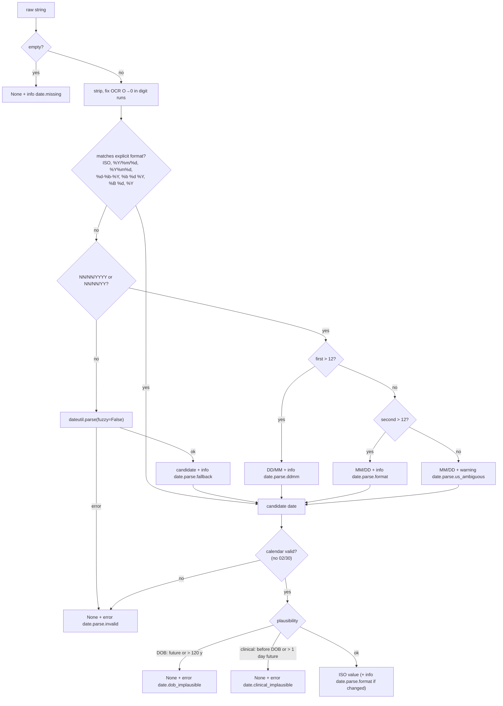
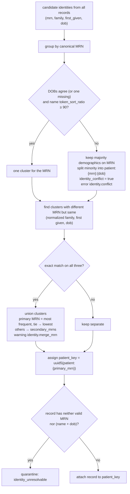
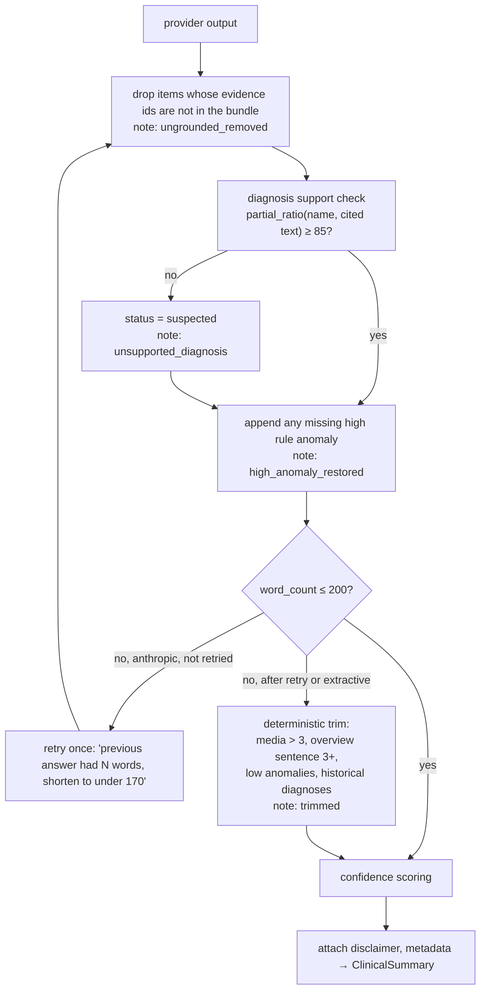
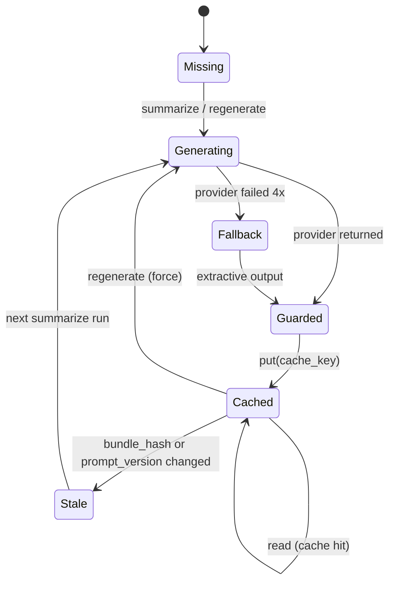
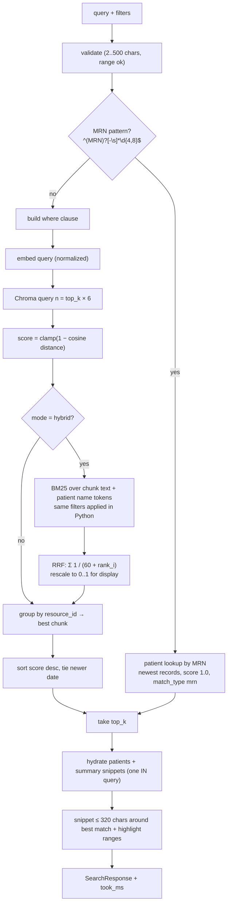

# 05. Algorithms

Every rule here is a pure function with unit tests. Rule ids (like `date.parse.us_ambiguous`) are the `rule` values written to the audit log.

## 1. Ingestion

### 1.1 Readers

| Reader | Behavior |
|---|---|
| `JsonReader` | Walk `patients → encounters → documents`. Emit one `patient` RawRecord per patient and one `document` RawRecord per document with patient keys copied in. Locator: `ehr_export.json:patients[3].encounters[0].documents[1]` |
| `CsvReader` | `csv.DictReader`; decode `utf-8-sig`, fall back to `latin-1` (audit `read.encoding_fallback`). One `lab_result` RawRecord per row. Locator: `lab_results.csv:row 17` |
| `TextReader` | Header regexes for `PATIENT`, `MRN`, `DOB`, `DATE OF SERVICE`, `DOCUMENT`, `ENCOUNTER`; body after `---`. Missing keys become missing fields. Locator: file name |

Reader exceptions never stop the run; the record goes to quarantine with `reason`.

### 1.2 Date normalization



Two-digit years pivot at the current year; a DOB is never in the future (subtract 100). Naive datetimes are interpreted as `America/New_York`.

### 1.3 Field rules

| Field | Rule id | Logic |
|---|---|---|
| gender | `gender.map` | `m, male, 1 → male`; `f, female, 2 → female`; `o, other, x, nonbinary → other`; `u, unk, unknown, "" → unknown` |
| gender | `gender.unmapped` (warning) | anything else → `unknown` |
| mrn | `mrn.normalize` | uppercase, drop `MRN`, punctuation, spaces; keep digits; zero-pad to 8 |
| mrn | `mrn.invalid` (error) | no digits or more than 8 digits → None |
| name | `name.normalize` | collapse spaces, strip titles (`Dr.`, `Mr.`, `Mrs.`, `Ms.`), parse `FAMILY, GIVEN MIDDLE` or `Given Middle Family`, smart title-case (`McDonald`, `O'Brien`, hyphens) |
| text | `text.normalize` | NFC, smart quotes to ASCII, `\r\n → \n`, collapse 3+ blank lines, strip trailing spaces |
| doc type | `doctype.map` | keyword map (`CT`, `MRI`, `X-RAY`, `ULTRASOUND`, `MAMMO` → imaging; `DISCHARGE` → discharge_summary; `PATHOLOGY`, `BIOPSY` → pathology; `PROGRESS` → progress_note; `CONSULT` → consult_note); default `scanned_document` (info) |
| lab value | `lab.value_parse` | handle `<0.01`, `>200`, `5.9 H`, OCR `l`→`1` inside numbers; keep `value_raw` |
| lab flag | `lab.flag_recomputed` | compute from range: `< low → L`, `> high → H`, critical table → `LL`/`HH`; audit when it overrides the source flag |
| phone | `contact.phone` | 10 US digits → E.164 (P1) |

Every rule returns `(new_value, list[AuditEntry])`. No entry when the value is unchanged.

### 1.4 Identity resolution



Implementation: union-find over candidate ids. Merge only on exact normalized equality; fuzzy similarity is used only to *confirm* same-MRN records, never to merge different MRNs.

### 1.5 Deduplication

| Rule | Condition | Keep |
|---|---|---|
| `dedupe.exact` | same `patient_key` and `content_hash` | record with most non-null fields, then earliest source |
| `dedupe.near` | same patient, same `doc_type`, dates within 1 day, `rapidfuzz.ratio(normalized_text) ≥ 97` | same as above |
| `dedupe.lab` | same patient, same LOINC or test name, same `collected_at`, same value | first seen |

Never across patients. Comparison only within `(patient_key, doc_type)` buckets, so cost stays small.

## 2. FHIR

### 2.1 Bundle hash
```python
def bundle_hash(bundle: dict) -> str:
    b = copy.deepcopy(bundle); b.pop("timestamp", None)
    for e in b["entry"]: e["resource"].get("meta", {}).pop("lastUpdated", None)
    return hashlib.sha256(orjson.dumps(b, option=orjson.OPT_SORT_KEYS)).hexdigest()
```

### 2.2 Validation rules

| Code | Severity | Check |
|---|---|---|
| `schema.invalid` | error | `fhir.resources.R4B` `model_validate` failure; path from pydantic `loc` converted to `Resource.field[0].sub` |
| `ref.unresolved` | error | reference not equal to any entry `fullUrl` in the bundle |
| `ref.subject_missing` | error | clinical resource lacks `subject` to the bundle Patient |
| `ref.result_not_observation` | error | DiagnosticReport `result` points to non-Observation |
| `docref.content_empty` | error | DocumentReference attachment has no data |
| `patient.identifier_missing` | error | Patient has no identifier |
| `patient.birthdate_missing` | info | no birthDate |
| `patient.identity_conflict` | warning | conflict tag present |
| `date.before_birth` | warning | resource date before birthDate |
| `date.future` | warning | resource date more than 1 day ahead |
| `encounter.missing` | info | document without encounter context |

`is_valid = (error_count == 0)`.

## 3. Summarization

### 3.1 Rule-based anomalies

| Rule | Severity |
|---|---|
| Observation interpretation `H` or `L` | moderate |
| `HH`/`LL` or critical: K > 6.0, K < 3.0, Na < 125, Na > 155, glucose > 400, lactate > 4.0, troponin above upper limit, Hb < 7 | high |
| Same LOINC worsening across 3+ results (monotonic in the abnormal direction) | moderate |
| Identity merged or conflict | low (data quality) |
| Record before DOB or in the future | low (data quality) |

### 3.2 Context builder (de-identified)

1. Compute age at the latest record date and sex; drop name, MRN, DOB, phone, address.
2. Order records newest first. Per record: id, type, date, title, then text. Imaging and pathology: IMPRESSION section first. Notes: ASSESSMENT/PLAN first, then the rest truncated to 1,200 chars. Labs: one line per report with flags.
3. Add rule anomalies as `<anomaly_hints>`.
4. Stop adding records at a 6,000 token estimate (`len(text) / 4`).
5. Unit test asserts no identifier of the patient (name parts, MRN digits, DOB) appears in the output.

```
<patient ref="P1" age="57" sex="female" />
<anomaly_hints>
- [high] Potassium 5.9 mmol/L (H, ref 3.5-5.1) 2025-02-02  evidence=Observation/5c3a…
</anomaly_hints>
<records>
<record id="DiagnosticReport/44f0…" type="imaging" date="2025-02-02" title="CT chest with contrast">IMPRESSION: …</record>
<record id="DocumentReference/0b8d…" type="discharge_summary" date="2025-02-04">ASSESSMENT: …</record>
<labs report="DiagnosticReport/9a1e…" date="2025-02-02">Potassium 5.9 H; Creatinine 2.1 H; Sodium 138 N</labs>
</records>
```

### 3.3 Prompt (version `v1`, `summarization/prompts.py`)

System:
```
You are a clinical documentation assistant that summarizes a patient's existing records for a clinician.
Rules:
1. Use ONLY facts inside <records> and <anomaly_hints>. Never infer diagnoses that are not written.
2. Every diagnosis, media record and anomaly must cite at least one record id exactly as given.
3. If information is missing, write "Not documented". Do not guess.
4. No treatment recommendations and no prognosis.
5. The whole summary (all fields together) must be under 180 words. Prefer clinical shorthand.
6. chief_concern: main reason for the most recent encounter, one sentence.
7. recent_media: most recent imaging, lab and pathology records, newest first, max 5.
8. flagged_anomalies: include every high severity hint; add your own only with evidence.
9. self_reported_confidence: "low" when records are sparse or conflicting.
```
User: one short synthetic example in `<example>` tags, then the context. Call: `messages.parse(model, max_tokens=800, temperature=0, system, messages, output_format=ClinicalSummaryLLM)`. Changing the prompt requires bumping `PROMPT_VERSION` (invalidates the cache).

### 3.4 Extractive provider (offline)

- chief_concern: first sentence of ASSESSMENT or IMPRESSION of the newest discharge summary or note; else "Not documented".
- key_diagnoses: match a curated dictionary (about 40 conditions with synonyms) against note text; evidence = matching records; status `active` if in the newest note, else `historical`.
- recent_media: newest 5 DiagnosticReports and imaging DocumentReferences; finding = conclusion first 120 chars.
- flagged_anomalies: rule anomalies.
- overview: template "{age}-year-old {sex} with {top diagnoses}; latest encounter {date} ({class})."
- self_reported_confidence: `low`.

### 3.5 Guardrails



Word count: whitespace tokens across `chief_concern`, diagnosis names, media findings, anomaly descriptions and `overview`.

**Confidence score**
```
base = {high: 0.85, medium: 0.65, low: 0.40}[self_reported]
score = base - 0.10 * guardrail_interventions
if records < 2 or identity_conflict: score = min(score, 0.40)
if provider == "extractive":        score = min(score, 0.50)
score = clamp(score, 0.10, 0.95)
level = high if score ≥ 0.75 else medium if score ≥ 0.50 else low
rationale = joined reasons (≤ 160 chars)
```

### 3.6 Summary lifecycle



### 3.7 Evaluation metrics (`make eval`)

| Metric | Definition | Target |
|---|---|---|
| Schema validity | outputs parsed without error | 100 percent |
| Length compliance | `word_count ≤ 200` | 100 percent |
| Disclaimer present | exact string | 100 percent |
| Grounding (pre-guardrail) | cited ids that exist / all cited ids | report |
| Grounding (final) | same after guardrails | 100 percent |
| Diagnosis support | diagnoses found in cited text | ≥ 95 percent |
| High anomaly recall | rule high anomalies present | 100 percent |
| Ground truth recall | generator conditions found in diagnoses (fuzzy) | ≥ 85 percent |
| Guardrail intervention rate | summaries with any note | report |
| Manual review | 10 random, scored 1 to 5 (accuracy, completeness, concision) in `docs/eval/manual_review.md` | mean ≥ 4 |

## 4. Search

### 4.1 Chunking

| Source | Text template |
|---|---|
| DocumentReference | `"{doc type label}: {title}. {date}. {decoded text}"` |
| DiagnosticReport | `"{category label} report: {code text}. {date}. Conclusion: {conclusion}. Results: {name value unit (flag); …}"` |
| Observation (off by default) | `"{test} {value} {unit} ({interpretation}) {date}"` |
| ClinicalSummary | `"Clinical summary. Chief concern: … Diagnoses: … Recent: … Anomalies: … Overview: …"` |

Split into sentence-aware windows of about 180 words with 30 words overlap (all-MiniLM-L6-v2 truncates at 256 word pieces). Names and MRNs are never embedded.

### 4.2 Query pipeline



### 4.3 Where clause
```python
def build_where(types, date_from, date_to, patient_key=None) -> dict | None:
    clauses = []
    if types: clauses.append({"resource_type": {"$in": list(types)}})
    if patient_key: clauses.append({"patient_key": patient_key})
    if date_from: clauses.append({"date_ord": {"$gte": date_from.toordinal()}})
    if date_to: clauses.append({"date_ord": {"$lte": date_to.toordinal()}})
    if date_from or date_to: clauses.append({"date_ord": {"$gt": 0}})
    if not clauses: return None
    return clauses[0] if len(clauses) == 1 else {"$and": clauses}   # Chroma rejects $and with fewer than 2 items
```

### 4.4 Highlights
Tokenize the query (lowercase, drop stop words, keep tokens ≥ 3 chars and clinical abbreviations like `ct`, `mri`, `k`), find case-insensitive whole-word matches in the snippet, merge overlapping ranges, return `[start, end)` pairs. The frontend wraps them in `<mark>`; it never injects HTML.

### 4.5 Performance budget

| Step | Budget |
|---|---|
| validate + where | < 1 ms |
| embed query (CPU, warm) | 10 to 30 ms |
| Chroma query (≈ 1.2k chunks) | < 20 ms |
| BM25 | < 10 ms |
| hydrate (one SQL) | < 5 ms |
| total p95 | < 300 ms (hard limit 2 s) |
