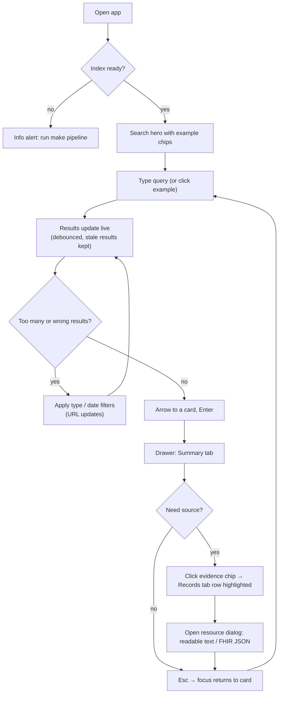
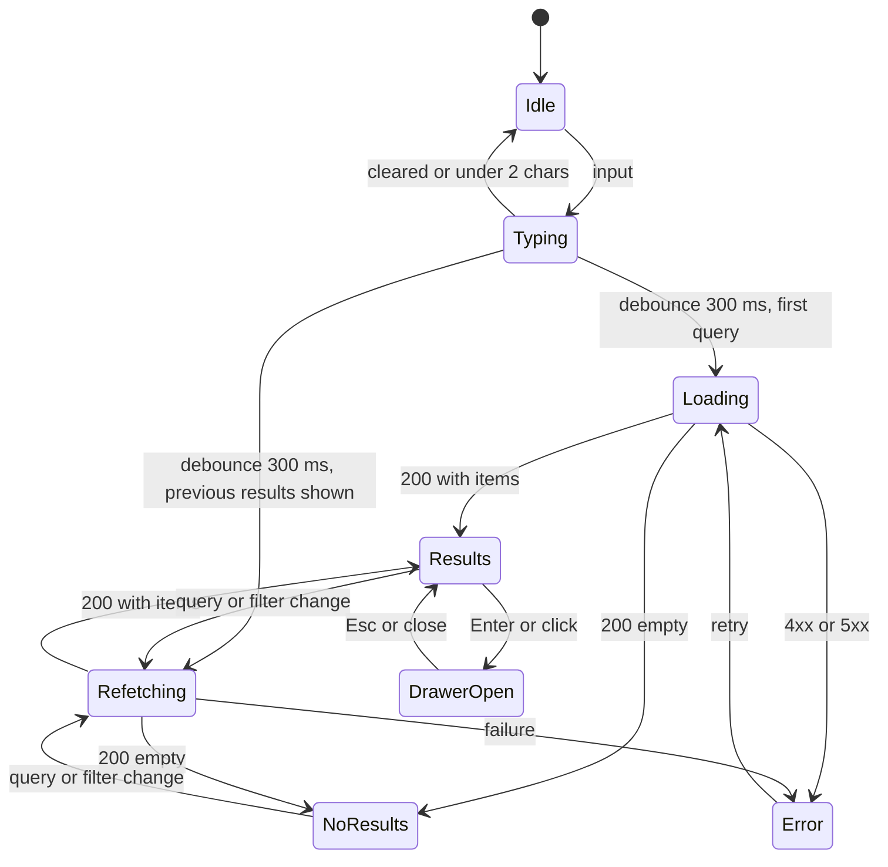

# 06. UI Design

Visual and interaction system for **EHR Media Intelligence** (product name in UI: **Media Intelligence**).
Source of truth for every color, type size, spacing value, component and screen. Agents must not invent values outside this file. Data each screen uses is defined in `04-API-CONTRACT.md` section 10.2.

---

## 1. Direction: "Clinical precision"

A calm, dense, trustworthy workspace. Think of a well-made instrument rather than a marketing site.

**Principles**

1. **Density with hierarchy.** Clinicians prefer seeing more per screen over extra clicks. Use tight spacing, but strong typographic hierarchy so the eye lands on patient, date and finding first.
2. **Color carries meaning, never decoration.** The surface is near-monochrome. One teal brand accent for interaction. Red is reserved for high severity anomalies and critical values, so it never loses urgency.
3. **AI is always labeled.** Anything model-generated carries the violet AI marker and the disclaimer. Source data never uses violet.
4. **Evidence over assertion.** Every AI claim links to its source record.
5. **Borders over shadows.** Hairline borders define structure. Shadows only for overlays (drawer, popover, dialog).
6. **Calm motion.** Short, functional transitions; none when reduced motion is requested.

**Avoid**: purple-to-blue gradients, glassmorphism, oversized hero sections, emoji, rounded "bubbly" cards, colored backgrounds on whole sections, stock medical imagery, decorative icons next to every label.

---

## 2. Inspiration and research notes

| Reference | What we take |
|---|---|
| Linear (getdesign.md/linear.app) | Precision, hairline borders, restrained accent used for focus and primary actions only, tight negative tracking on headings |
| Vercel / Geist (getdesign.md/vercel.com) | Geist Sans and Geist Mono, black-and-white clarity, mono for identifiers |
| Notion (getdesign.md/notion.so) | Off-white canvas and one confident accent for readable long text in the drawer |
| Shadcn UI Kit Hospital (via AdminLTE 2026 roundup) | Near-monochrome dashboards where green and red appear only on meaningful change |
| Canvas Medical (via AdminLTE roundup) | Accent-outlined focus states showing the active card and its section together |
| AdminLTE healthcare dashboard lessons | Density favored by clinicians; encode urgency by severity not category; reserve strongest color for must-not-miss states; label values directly |

Pull the getdesign references locally for the agent with `npx getdesign@latest add linear.app` and `npx getdesign@latest add vercel.com` into `docs/design-refs/`. They are references only; this document wins on any conflict.

---

## 3. Color tokens

Tailwind v4 + shadcn CSS variables, OKLCH. Light is the default (clinical environments are bright); dark follows system preference with a manual toggle.

### 3.1 Core (shadcn names)

| Token | Light | Dark | Use |
|---|---|---|---|
| `--background` | `oklch(0.985 0.002 247)` | `oklch(0.16 0.008 257)` | App canvas |
| `--foreground` | `oklch(0.205 0.015 257)` | `oklch(0.96 0.004 247)` | Primary text |
| `--card` | `oklch(1 0 0)` | `oklch(0.195 0.009 257)` | Result cards, panels |
| `--card-foreground` | `oklch(0.205 0.015 257)` | `oklch(0.96 0.004 247)` | |
| `--popover` | `oklch(1 0 0)` | `oklch(0.21 0.01 257)` | Popovers, drawer, dialogs |
| `--popover-foreground` | `oklch(0.205 0.015 257)` | `oklch(0.96 0.004 247)` | |
| `--primary` | `oklch(0.50 0.09 196)` | `oklch(0.72 0.10 192)` | Clinical teal: primary buttons, links, active nav |
| `--primary-foreground` | `oklch(0.985 0.005 196)` | `oklch(0.18 0.03 196)` | Text on primary |
| `--secondary` | `oklch(0.955 0.006 247)` | `oklch(0.24 0.01 257)` | Secondary buttons, chips |
| `--secondary-foreground` | `oklch(0.25 0.015 257)` | `oklch(0.94 0.004 247)` | |
| `--muted` | `oklch(0.962 0.004 247)` | `oklch(0.24 0.01 257)` | Subtle fills, skeletons, table header |
| `--muted-foreground` | `oklch(0.50 0.016 257)` | `oklch(0.70 0.012 257)` | Meta text (dates, labels) |
| `--accent` | `oklch(0.95 0.02 196)` | `oklch(0.27 0.03 196)` | Hover and selected row/card tint |
| `--accent-foreground` | `oklch(0.30 0.06 196)` | `oklch(0.92 0.03 196)` | |
| `--destructive` | `oklch(0.53 0.20 27)` | `oklch(0.68 0.19 25)` | High severity, critical values, errors |
| `--border` | `oklch(0.915 0.005 247)` | `oklch(1 0 0 / 9%)` | Hairlines |
| `--input` | `oklch(0.89 0.006 247)` | `oklch(1 0 0 / 14%)` | Input fills |
| `--input-border` | `oklch(0.64 0.01 247)` | `oklch(0.53 0.01 257)` | Control borders, at least 3:1 |
| `--ring` | `oklch(0.58 0.10 196)` | `oklch(0.72 0.10 192)` | Focus ring |

### 3.2 Semantic additions

| Token | Light | Dark | Use |
|---|---|---|---|
| `--warning` | `oklch(0.72 0.15 70)` | `oklch(0.78 0.14 75)` | Moderate severity, ambiguous data, identity conflicts |
| `--warning-foreground` | `oklch(0.36 0.08 60)` | `oklch(0.22 0.05 70)` | |
| `--success` | `oklch(0.58 0.13 155)` | `oklch(0.72 0.14 155)` | Valid bundle, cache hit, normal |
| `--info` | `oklch(0.55 0.12 245)` | `oklch(0.72 0.11 245)` | Neutral notices |
| `--ai` | `oklch(0.52 0.16 290)` | `oklch(0.74 0.13 290)` | AI marker, AI badge text, AI card left rule |
| `--ai-muted` | `oklch(0.965 0.018 290)` | `oklch(0.24 0.04 290)` | AI badge and AI panel background |

### 3.3 Resource type colors (badges only, as text + tinted bg + border)

| Resource | Hue token | Light text / bg | Label |
|---|---|---|---|
| DocumentReference | `--rt-document` | `oklch(0.45 0.12 250)` / `oklch(0.96 0.02 250)` | "Document" |
| DiagnosticReport | `--rt-report` | `oklch(0.45 0.09 170)` / `oklch(0.96 0.025 170)` | "Diagnostic report" |
| Observation | `--rt-observation` | `oklch(0.47 0.10 70)` / `oklch(0.965 0.03 80)` | "Observation" |
| ClinicalSummary | `--ai` | AI tokens | "AI summary" |

Dark mode: raise lightness of text to about 0.78 and use `oklch(<hue> / 14%)` backgrounds.

Severity mapping: `high → destructive`, `moderate → warning`, `low → muted` (neutral, not green). Normal lab values are plain text, never green, to keep alerts meaningful.

---

## 4. Typography

Fonts: **Geist Variable** (UI) and **Geist Mono Variable** (MRN, ids, codes, numbers in tables). Install via `@fontsource-variable/geist` and `@fontsource-variable/geist-mono`. Enable `font-feature-settings: "tnum"` on numeric columns, scores and dates (`tabular-nums` utility).

| Token | Size / line height | Weight | Tracking | Use |
|---|---|---|---|---|
| `text-display` | 28 / 34 | 600 | -0.02em | Search hero title only |
| `text-title` | 20 / 28 | 600 | -0.015em | Page titles, drawer patient name |
| `text-heading` | 15 / 22 | 600 | -0.01em | Section headings in drawer and cards |
| `text-body` | 14 / 22 | 400 | 0 | Default UI text |
| `text-body-strong` | 14 / 22 | 500 | 0 | Patient name in card, table emphasis |
| `text-small` | 13 / 20 | 400 | 0 | Snippets, table cells |
| `text-meta` | 12 / 16 | 500 | 0.01em | Dates, labels, badge text |
| `text-mono` | 12.5 / 18 | 450 | 0 | MRN, resource ids, LOINC codes |
| `text-overline` | 11 / 16 | 600 | 0.06em uppercase | Section labels in drawer ("CHIEF CONCERN") |

Base font size 14 px (dense app), set on `body` via `text-body`; the root font size stays at the browser default. Body text max line length about 75 characters in the drawer.

---

## 5. Spacing, radius, elevation, motion

- **Spacing**: 4 px grid. Common steps 4, 8, 12, 16, 20, 24, 32, 48. Card padding 16 (mobile 12). Gap between result cards 8. Section gap in drawer 24.
- **Radius**: `--radius: 0.5rem` (8 px). Cards and drawer inner panels 10 px, inputs and buttons 8 px, badges 6 px, chips full pill.
- **Borders**: 1 px `--border` everywhere; selected card 1 px `--ring` plus 3 px inset left rule in `--primary`.
- **Elevation**: none for cards. Overlays: `0 8px 24px -8px oklch(0.2 0.02 257 / 0.18), 0 2px 6px -2px oklch(0.2 0.02 257 / 0.10)`. Dark overlays rely on lighter surface plus border.
- **Motion**: 120 ms hover and color, 160 ms popovers, 200 ms drawer slide (`cubic-bezier(0.32, 0.72, 0, 1)`), skeleton shimmer 1.4 s. All disabled under `prefers-reduced-motion: reduce`.
- **Icons**: lucide-react, 16 px in UI, 14 px inside badges, stroke 1.75. Icons support labels, never replace them.

---

## 6. Components

### 6.1 Top bar
Height 56, `bg-background/80` with backdrop blur, bottom border. Left: product mark (small teal square glyph + "Media Intelligence" in `text-heading`). Center/left nav: Search, Patients, Data quality (active item `text-foreground` with 2 px bottom indicator in primary). Right: stats pill ("60 patients · 248 records" in `text-meta`), theme toggle, shortcuts button (`?`).

### 6.2 Search input
- Height 48, radius 10, `bg-card`, border `--input`, left search icon, right side: spinner while fetching, clear button, `Kbd` "/" hint when empty.
- Focus: border `--ring` plus 3 px ring at 25 percent opacity.
- Placeholder: "Search records, e.g. 'rising creatinine' or 'CT chest pulmonary embolism'".
- Visible label above in `text-meta` ("Search patient records"); may be visually hidden on desktop only if the placeholder is not the only label (keep `aria-label`).

### 6.3 Filter bar
Row under input, gap 8: `ResourceTypeFilter` (outline button "Type: All" → popover with checkbox list and colored dots), `DateRangeFilter` (outline button with calendar icon "Any date" → popover with presets column: Last 30 days, Last 6 months, Last year, This year, Custom; and a two-month range calendar), active filter chips (secondary pill with x), "Clear filters" ghost button. On mobile the row collapses into a single "Filters (2)" button opening a bottom sheet.

### 6.4 Results meta
`text-meta muted-foreground`: "5 results · 41 ms · Hybrid" on the left ("5 results · 4 ms · Newest first" in newest order), a labeled "Sort by" select on the right (Relevance, Newest), kept in the URL as `sort=newest`. In newest order a note says what qualifies ("Records with every search word. AI summaries are left out and undated records come last."), score meters and similarity are hidden, and no results offers "Sort by relevance". This element is the `aria-live="polite"` region.

### 6.5 Result card

```
┌───────────────────────────────────────────────────────────────────────────────┐
│ Jane A. Doe   MRN 00012345 ⧉   57 F                       0.81 ▮▮▮▮▯          │
│ [Diagnostic report]  Feb 2, 2025 · Basic metabolic panel                      │
│ …Potassium 5.9 mmol/L (H)… Creatinine 2.1 mg/dL (H) compared with 1.4…        │
│ ✦ AI  Chief concern: acute kidney injury on CKD stage 3 with hyperkalemia.    │
└───────────────────────────────────────────────────────────────────────────────┘
```
- Whole card is a button. Padding 16, radius 10, border; hover `bg-accent/40`; focused or selected: ring border plus 3 px primary left rule.
- Line 1: name `text-body-strong`, MRN in `text-mono muted-foreground` with copy button (appears on hover and focus), age and sex `text-meta`. Conflict badge (warning) when identity conflict.
- Line 2: resource type badge, date (`tabular-nums`), title truncated with tooltip.
- Snippet: `text-small`, 2 lines clamp, matched terms in `<mark>` styled `bg-primary/12 text-foreground rounded-sm px-0.5`.
- AI line: AI badge (violet sparkle icon + "AI") then chief concern, 1 line clamp, `text-small`.
- Score meter: numeric `0.81` in `text-mono` plus 5 segment bar (segments 4 x 10, gap 2, filled `--primary`, empty `--muted`). `aria-label="Relevance 81 percent"`.

### 6.6 Badges
- Resource type: tinted bg, 1 px border at 30 percent of hue, `text-meta`, radius 6, height 22, colored dot 6 px.
- Severity: high (destructive tint + solid dot), moderate (warning tint), low (muted).
- Status: Valid (success outline), Invalid (destructive outline), Cached (muted outline with database icon).
- AI badge: `bg-ai-muted text-ai`, sparkle icon 12 px, label "AI".

### 6.7 Patient drawer
- shadcn `Sheet` side right, width 560 (lg), 480 (md), full screen on mobile. `bg-popover`, overlay shadow, close button top right, Esc closes.
- **Header** (sticky): name `text-title`; second line MRN mono + copy, age/sex, DOB; secondary MRNs listed as "Also known as MRN 00098765"; identity conflict `Alert` (warning) when flagged.
- **Tabs** (underline style): Summary, Records (count), Timeline, Data quality.
- **Summary tab**
  - Disclaimer banner at top: `bg-ai-muted`, left rule 3 px `--ai`, info icon, text in `text-small`. Always visible, not dismissible.
  - Sections with `text-overline` labels: CHIEF CONCERN (body text), KEY DIAGNOSES (list: name, status badge, evidence links as small mono chips "DR · Feb 2"), RECENT MEDIA (compact table rows: kind icon, date, finding), FLAGGED ANOMALIES (severity badge + description + evidence chip; high first), OVERVIEW (paragraph).
  - Footer meta row: Confidence meter (label + 3 step bar + score), model, prompt version, generated time, Cached badge, Regenerate button (ghost, P2).
  - The whole AI panel has a 2 px left rule in `--ai` to separate generated from source content.
- **Records tab**: TanStack Table inside shadcn `Table`: columns Type (badge), Date, Title, Status, actions. Toolbar with type filter and text filter. Dense rows (height 40), sticky header `bg-muted`. Row click opens Resource dialog with decoded text (readable) and FHIR JSON tab (mono, syntax colored, copy).
- Evidence chip click → switch to Records tab, scroll to and briefly highlight the row (`bg-accent`, 1.2 s fade).

### 6.8 Tables (directory, records, quality)
Dense: header 36, rows 40, `text-small`, numeric columns right aligned with `tabular-nums`, ids in mono. Sort indicator icons in header buttons (with `aria-sort`). Pagination footer: "Rows 1 to 25 of 60" + previous/next + page size select.

### 6.9 States
- **Loading**: 5 skeleton cards mirroring card layout; in drawer, skeleton sections. Inline spinner in input while refetching (results stay visible).
- **Empty (before query)**: centered block, `text-heading` "Search across every patient record", helper text, 4 example query chips (click fills and runs).
- **No results**: "No records match" + tips (remove filters, try broader terms) + "Clear filters" button when filters active.
- **Error**: destructive outline alert with retry button and request id in mono for support.
- **Pipeline not run** (503 `search_index_empty`): info alert "No records indexed yet. Run `make pipeline`."

### 6.10 Data quality page (P1)
KPI strip of 6 tiles (border cards, numbers `text-title tabular-nums`, label `text-meta`): Records ingested, Duplicates removed, Identities merged, Conflicts flagged, Bundles valid (x of y), Validation issues. No sparklines needed. Below: tabs Validation issues | Audit log | Quarantine, each a dense TanStack Table with severity filter.

### 6.11 Toasts
sonner, bottom right, neutral style; used for "Copied MRN", "Summary regenerated". Never for errors that need action (use inline alerts).

---

## 7. Layouts

### 7.1 Search page (desktop 1440)

```
┌──────────────────────────────────────────────────────────────────────────────────────────────┐
│ ▪ Media Intelligence   Search  Patients  Data quality          60 patients · 248 records ◐ ? │
├──────────────────────────────────────────────────────────────────────────────────────────────┤
│                     (max width 1120, centered)                                               │
│  Search patient records                                                                      │
│  ┌──────────────────────────────────────────────────────────────────────────────────── / ┐   │
│  │ 🔍  rising creatinine with high potassium                                          ✕  │   │
│  └───────────────────────────────────────────────────────────────────────────────────────┘   │
│  [Type: Diagnostic report ▾] [📅 Last 6 months ▾]  (Diagnostic report ✕) (Last 6 months ✕)   │
│                                                                                              │
│  5 results · 41 ms · Hybrid                                          Ranked by relevance     │
│  ┌ result card ───────────────────────────────────────────────────────────────────────────┐  │
│  └────────────────────────────────────────────────────────────────────────────────────────┘  │
│  ┌ result card ───────────────────────────────────────────────────────────────────────────┐  │
│  └────────────────────────────────────────────────────────────────────────────────────────┘  │
│  ...                                                                                         │
└──────────────────────────────────────────────────────────────────────────────────────────────┘
```

### 7.2 Search page with drawer open

```
┌────────────────────────────────────────────────────────┬─────────────────────────────────────┐
│ (results dimmed by overlay at 20 percent)               │ Jane A. Doe                      ✕  │
│                                                         │ MRN 00012345 ⧉ · 57 F · 14 Mar 1968 │
│                                                         │ ⚠ Identity merged from 2 MRNs       │
│                                                         │ Summary | Records 12 | Timeline | DQ│
│                                                         │ ┃ ✦ AI-generated summary for ...   │
│                                                         │ ┃ CHIEF CONCERN                     │
│                                                         │ ┃ Acute kidney injury on CKD 3 ...  │
│                                                         │ ┃ KEY DIAGNOSES                     │
│                                                         │ ┃ • CKD stage 3  active  [DR·Feb 2] │
│                                                         │ ┃ RECENT MEDIA                      │
│                                                         │ ┃ FLAGGED ANOMALIES                 │
│                                                         │ ┃ [High] Potassium 5.9 mmol/L ...   │
│                                                         │ ┃ Confidence ▮▮▯ medium 0.65        │
└────────────────────────────────────────────────────────┴─────────────────────────────────────┘
```

### 7.3 Mobile (390)
Top bar collapses nav into a menu button. Search input full width, "Filters (n)" button opens bottom sheet. Cards: score moves to top right as number only, snippet 3 lines. Drawer is full screen with a back arrow.

---

## 8. Screens, flows and interaction

### 8.1 Screen inventory

| Screen | Route | Tier | Key components | Endpoints |
|---|---|---|---|---|
| Search | `/` | R | TopBar, SearchInput, FilterBar, ResultsMeta, ResultList, ResultCard, states | `POST /search`, `GET /stats` |
| Patient drawer | `/?patient={key}` (also on `/patients`) | R | DrawerHeader, Tabs, SummaryPanel, ResourceTable, ResourceDialog | `GET /patients/{key}`, `/summary`, `/resources`, `GET /resources/{type}/{id}` |
| Patients directory | `/patients` | P1 | DirectoryToolbar, DirectoryTable, Pagination | `GET /patients` |
| Data quality | `/quality` | P1 | KpiStrip, Tabs, IssuesTable, AuditTable, QuarantineTable | `GET /quality/*` |
| Shortcuts dialog | overlay | P1 | Dialog, Kbd list | none |

### 8.2 Primary user flow



### 8.3 Search state machine



| State | UI |
|---|---|
| Idle | Hero, example chips |
| Loading | 5 skeleton cards, input spinner |
| Refetching | previous cards at full opacity, input spinner, live region silent until done |
| Results | cards, meta "5 results · 41 ms · Hybrid" |
| NoResults | message + tips + clear filters |
| Error | alert with retry and request id |

### 8.4 Keyboard model

| Key | Context | Action |
|---|---|---|
| `/` or `Ctrl/Cmd+K` | anywhere | focus search input |
| `Esc` | input with text | clear input |
| `Esc` | drawer or dialog open | close, restore focus |
| `↓` | input | focus first result |
| `↑` / `↓` | results | previous / next result |
| `Home` / `End` | results | first / last result |
| `Enter` | result | open drawer |
| `[` / `]` | drawer | previous / next tab |
| `?` | anywhere except inputs | shortcuts dialog |

Implemented with a `useRovingFocus` hook; cards are `<li><button>`; no positive tabindex.

### 8.5 Component contracts

| Component | Props | Notes |
|---|---|---|
| `SearchInput` | `value, onChange, isFetching, inputRef` | Controlled draft; parent debounces into URL |
| `FilterBar` | `types, from, to, onChange(next)` | Validates `from ≤ to` with Zod before calling `onChange` |
| `ResourceTypeFilter` | `value: SearchableType[], onChange` | Popover + checkbox list with colored dots |
| `DateRangeFilter` | `from, to, onChange` | Popover, presets column, two-month range calendar |
| `ResultList` | `results: SearchResult[], onOpen(patientKey, resourceId)` | Roving focus, `aria-label="Search results"` |
| `ResultCard` | `result: SearchResult, onOpen, onPrefetch` | Prefetch on hover and focus |
| `ScoreMeter` | `score: number, size?: "sm" \| "md"` | `aria-label="Relevance {n} percent"` |
| `ResourceTypeBadge` | `type: SearchableType \| "Encounter"` | Color by type token |
| `AiBadge` | none | Violet marker |
| `Highlight` | `text, ranges: [number, number][]` | Renders `<mark>` segments, no HTML injection |
| `PatientDrawer` | `patientKey: string \| null, onClose` | Driven by `?patient` |
| `SummaryPanel` | `summary: ClinicalSummaryResponse, onEvidence(ref)` | Disclaimer always first |
| `ResourceTable` | `items: PatientResourceItem[], highlightedId?, onOpen(ref)` | TanStack Table v9: sort, type filter, text filter |
| `ResourceDialog` | `ref: EvidenceRef \| null, onClose` | Tabs: Readable, FHIR JSON |
| `DirectoryTable` | `params, onParamsChange` | Server-side pagination and sort |
| `EmptyState` / `ErrorState` | `title, description, action?` / `error: ApiError, onRetry` | ErrorState shows request id |

### 8.6 Responsive behavior

| Width | Behavior |
|---|---|
| ≥ 1280 | content max 1120, drawer 560 |
| 768 to 1279 | filters wrap, drawer 480 |
| < 768 | nav in menu, "Filters (n)" bottom sheet, score as number only, drawer full screen with back arrow |

## 9. Accessibility rules (non-negotiable)

- Contrast: body text 4.5:1, large text and UI boundaries 3:1, verified in both themes.
- Focus ring visible on every interactive element (`outline: 2px solid var(--ring); outline-offset: 2px` or the shadcn ring utilities).
- Never encode meaning by color alone: severity has a label, score has a number, validity has text.
- Hit targets at least 32 px (44 px on touch layouts).
- Live region for result count and errors; drawer `aria-labelledby` the patient name.
- Keyboard model as in section 8. Shortcuts dialog lists them.
- `lang="en"` on html; dates rendered as text like "Feb 2, 2025" with `<time dateTime="2025-02-02">`.

---

## 10. Ready-to-paste `src/index.css`

```css
@import "tailwindcss";
@import "tw-animate-css";
@import "@fontsource-variable/geist";
@import "@fontsource-variable/geist-mono";

@custom-variant dark (&:is(.dark *));

:root {
  --radius: 0.5rem;
  --background: oklch(0.985 0.002 247);
  --foreground: oklch(0.205 0.015 257);
  --card: oklch(1 0 0);
  --card-foreground: oklch(0.205 0.015 257);
  --popover: oklch(1 0 0);
  --popover-foreground: oklch(0.205 0.015 257);
  --primary: oklch(0.50 0.09 196);
  --primary-foreground: oklch(0.985 0.005 196);
  --secondary: oklch(0.955 0.006 247);
  --secondary-foreground: oklch(0.25 0.015 257);
  --muted: oklch(0.962 0.004 247);
  --muted-foreground: oklch(0.50 0.016 257);
  --accent: oklch(0.95 0.02 196);
  --accent-foreground: oklch(0.30 0.06 196);
  --destructive: oklch(0.53 0.20 27);
  --border: oklch(0.915 0.005 247);
  --input: oklch(0.89 0.006 247);
  --input-border: oklch(0.64 0.01 247);
  --ring: oklch(0.58 0.10 196);
  --warning: oklch(0.72 0.15 70);
  --warning-foreground: oklch(0.36 0.08 60);
  --success: oklch(0.58 0.13 155);
  --info: oklch(0.55 0.12 245);
  --ai: oklch(0.52 0.16 290);
  --ai-muted: oklch(0.965 0.018 290);
  --rt-document: oklch(0.45 0.12 250);
  --rt-document-bg: oklch(0.96 0.02 250);
  --rt-report: oklch(0.45 0.09 170);
  --rt-report-bg: oklch(0.96 0.025 170);
  --rt-observation: oklch(0.47 0.10 70);
  --rt-observation-bg: oklch(0.965 0.03 80);
}

.dark {
  --background: oklch(0.16 0.008 257);
  --foreground: oklch(0.96 0.004 247);
  --card: oklch(0.195 0.009 257);
  --card-foreground: oklch(0.96 0.004 247);
  --popover: oklch(0.21 0.01 257);
  --popover-foreground: oklch(0.96 0.004 247);
  --primary: oklch(0.72 0.10 192);
  --primary-foreground: oklch(0.18 0.03 196);
  --secondary: oklch(0.24 0.01 257);
  --secondary-foreground: oklch(0.94 0.004 247);
  --muted: oklch(0.24 0.01 257);
  --muted-foreground: oklch(0.70 0.012 257);
  --accent: oklch(0.27 0.03 196);
  --accent-foreground: oklch(0.92 0.03 196);
  --destructive: oklch(0.68 0.19 25);
  --border: oklch(1 0 0 / 9%);
  --input: oklch(1 0 0 / 14%);
  --input-border: oklch(0.53 0.01 257);
  --ring: oklch(0.72 0.10 192);
  --warning: oklch(0.78 0.14 75);
  --warning-foreground: oklch(0.22 0.05 70);
  --success: oklch(0.72 0.14 155);
  --info: oklch(0.72 0.11 245);
  --ai: oklch(0.74 0.13 290);
  --ai-muted: oklch(0.24 0.04 290);
  --rt-document: oklch(0.78 0.10 250);
  --rt-document-bg: oklch(0.55 0.12 250 / 14%);
  --rt-report: oklch(0.78 0.09 170);
  --rt-report-bg: oklch(0.55 0.09 170 / 14%);
  --rt-observation: oklch(0.80 0.10 75);
  --rt-observation-bg: oklch(0.60 0.10 75 / 14%);
}

@theme inline {
  --font-sans: "Geist Variable", ui-sans-serif, system-ui, sans-serif;
  --font-mono: "Geist Mono Variable", ui-monospace, SFMono-Regular, monospace;
  /* By role (section 5): badges md 6, inputs and buttons lg 8 (shadcn uses rounded-lg), cards xl 10 */
  --radius-sm: calc(var(--radius) - 4px);
  --radius-md: calc(var(--radius) - 2px);
  --radius-lg: var(--radius);
  --radius-xl: calc(var(--radius) + 2px);
  --radius-2xl: calc(var(--radius) + 6px);
  --color-background: var(--background);
  --color-foreground: var(--foreground);
  --color-card: var(--card);
  --color-card-foreground: var(--card-foreground);
  --color-popover: var(--popover);
  --color-popover-foreground: var(--popover-foreground);
  --color-primary: var(--primary);
  --color-primary-foreground: var(--primary-foreground);
  --color-secondary: var(--secondary);
  --color-secondary-foreground: var(--secondary-foreground);
  --color-muted: var(--muted);
  --color-muted-foreground: var(--muted-foreground);
  --color-accent: var(--accent);
  --color-accent-foreground: var(--accent-foreground);
  --color-destructive: var(--destructive);
  --color-border: var(--border);
  --color-input: var(--input);
  --border-color-input: var(--input-border);
  --color-ring: var(--ring);
  --color-warning: var(--warning);
  --color-warning-foreground: var(--warning-foreground);
  --color-success: var(--success);
  --color-info: var(--info);
  --color-ai: var(--ai);
  --color-ai-muted: var(--ai-muted);
  --color-rt-document: var(--rt-document);
  --color-rt-document-bg: var(--rt-document-bg);
  --color-rt-report: var(--rt-report);
  --color-rt-report-bg: var(--rt-report-bg);
  --color-rt-observation: var(--rt-observation);
  --color-rt-observation-bg: var(--rt-observation-bg);
  --text-display: 1.75rem;   --text-display--line-height: 2.125rem;
  --text-title: 1.25rem;     --text-title--line-height: 1.75rem;
  --text-heading: 0.9375rem; --text-heading--line-height: 1.375rem;
  --text-body: 0.875rem;     --text-body--line-height: 1.375rem;
  --text-small: 0.8125rem;   --text-small--line-height: 1.25rem;
  --text-meta: 0.75rem;      --text-meta--line-height: 1rem;
}

@layer base {
  * { @apply border-border outline-ring/50; }
  /* Root stays at the browser default (16px) so rem tokens match the px table in section 4,
     Tailwind spacing stays on the 4px grid and user font scaling is respected. */
  body { @apply bg-background text-body text-foreground font-sans antialiased; }
  code, kbd, .font-mono { font-feature-settings: "zero" 1; }
  @media (prefers-reduced-motion: reduce) {
    *, *::before, *::after { animation-duration: 0.01ms !important; transition-duration: 0.01ms !important; }
  }
}
```

Note: if the shadcn CLI generates its own `index.css`, merge these values into the generated variables instead of keeping two sets. The implemented file (`frontend/src/index.css`) also adds per-token font weight and letter spacing (`--text-*--font-weight`, `--text-*--letter-spacing`), the `text-mono` and `text-overline` tokens from section 4, and `shadow-overlay` from section 5. Check contrast of `--muted-foreground` and badge text once rendered and nudge lightness by 0.02 steps if any pair fails AA.

---

## 11. Design QA checklist (run per screen)

- [ ] Only tokens used; no raw hex or arbitrary colors in components.
- [ ] Hierarchy reads in this order: patient → resource and date → finding → AI line → score.
- [ ] Red appears only for high severity, critical values or errors.
- [ ] Every AI element has the AI marker; disclaimer visible in Summary tab.
- [ ] Keyboard path works end to end; focus is always visible.
- [ ] Light and dark both pass contrast.
- [ ] 390, 1024, 1440 px screenshots reviewed.
- [ ] Loading, empty, no results, error, index-empty states each reviewed.
- [ ] Copy follows section 14 (sentence case, units, dates, error formula).
- [ ] AI elements follow section 12 (label, disclaimer, citations, confidence rationale, provenance, feedback).
- [ ] Performance budget in section 15 met (Lighthouse CI).
- [ ] Storybook stories exist for any new shared component.

---

## 12. AI UX components

### 12.1 Summary panel anatomy

```
┃ ✦ AI summary · Generated Feb 4, 2025 10:02 · claude-haiku-5-5 · v1 · Cached          [⟳ Regenerate]
┃ ⓘ AI-generated summary for information retrieval only. Not a clinical decision. Verify against source records.
┃
┃ CHIEF CONCERN
┃ Admitted for acute kidney injury on CKD stage 3 with hyperkalemia.
┃
┃ KEY DIAGNOSES
┃ • Chronic kidney disease stage 3   [Active]      ⟶ Discharge summary · Feb 4
┃ • Hyperkalemia                      [Active]      ⟶ Potassium · Feb 2
┃ • Pulmonary embolism                [Suspected ⚠] ⟶ CT angiography · Jan 9     (not found verbatim in source)
┃
┃ RECENT MEDIA            kind     date     finding
┃                         Lab      Feb 2    K 5.9 H, creatinine 2.1 H        ⟶
┃                         Imaging  Feb 2    CT chest: no acute process        ⟶
┃
┃ FLAGGED ANOMALIES
┃ [High]      Potassium 5.9 mmol/L above range (3.5 to 5.1)                   ⟶
┃ [Low · DQ]  Record merged from two MRNs
┃
┃ OVERVIEW
┃ 57-year-old female with CKD 3 admitted with AKI and hyperkalemia ...
┃
┃ Confidence  ▮▮▯ Medium 0.65  ⓘ                Was this summary helpful?  [👍 Helpful] [👎 Not helpful]
```

### 12.2 Component rules

| Element | Spec |
|---|---|
| Provenance header | `text-meta muted-foreground`: AI badge, generated time (absolute), model id in mono, prompt version, Cached badge. Extractive provider shows "Offline summary" badge in `info` instead of model id |
| Disclaimer | Always visible, first block, `bg-ai-muted`, info icon, not dismissible, not collapsible |
| Evidence chip | Mono `text-meta`, arrow icon, "{resource label} · {date}"; `aria-label="Open source: Discharge summary · Feb 4, 2025"` (contains the visible label, WCAG 2.5.3); click → Records tab row highlight |
| Suspected diagnosis | `warning` badge "Suspected" + tooltip "Not found verbatim in the cited record. Verify in source." |
| Data quality anomaly | Badge suffix "DQ" with tooltip "Data quality issue, not a clinical finding" |
| "Not documented" | Muted italic text in place of the value. Never hide the section |
| Confidence | 3 step bar + level + score; info icon opens popover listing `confidence.rationale` and `guardrail_notes` in plain language |
| Feedback | Two outline buttons. Not helpful opens an inline popover with reason radio group + optional comment (280 chars counter) + Submit. After submit: "Thanks. Feedback saved for prompt v1." Buttons become a static state. Optimistic update, rollback on error |
| Regenerate | Ghost button with confirm popover "Regenerate uses the AI service and replaces this summary. Continue?" Disabled with tooltip when budget exceeded or rate limited |
| Generating state | Skeleton blocks + text "Generating summary…" with `aria-busy="true"`; no spinner longer than 45 s, then error state |
| Fallback notice | Info alert: "AI service unavailable. Showing an offline summary built from the records." The provenance header names the reason: "Daily AI limit reached", "AI declined this record" or "AI request failed" |
| Missing summary | Empty state: "No summary yet" + "Run the pipeline to generate summaries." |

### 12.3 "Why this result" (search transparency)

Info icon next to the score on each result card opens a popover:
```
Why this result
Match: Hybrid (meaning + keywords)
Semantic similarity: 0.73
Matched terms: potassium, kidney
Record type: Diagnostic report · Feb 2, 2025
```
AI summary results show "Matched the AI summary for this patient" so users know the hit came from generated text, not a source document.

### 12.4 First-run onboarding (P1)

On first visit (flag in localStorage, guarded with try/catch), a dismissible inline tip row under the search input: "Tip: press / to search from anywhere, use ↑ ↓ and Enter to open a patient." The example query chips act as the rest of the onboarding. No modal tours.

## 13. UX principles for clinical work

| Principle | How it shows up |
|---|---|
| Glanceability | Patient, date, type and finding readable in one scan of a card; numbers with units and flags |
| Interruption recovery | All state in the URL; browser back closes the drawer; recent searches (P2); the drawer reopens on the same tab |
| Recognition over recall | Example queries, filter presets, active filter chips, type colors consistent everywhere |
| Error prevention | Date range picker cannot select `from > to`; disabled actions explain why in a tooltip |
| Safety first | Never truncate a value with a unit or flag; critical values never rely on color only; AI content always labeled |
| Consistency | One badge style per meaning; the same resource label text in search, drawer and tables |
| Speed perception | Keep stale results visible while refetching; prefetch on hover; skeletons only after 150 ms to avoid flashing |
| Minimal interruption | Toasts only for confirmations; errors are inline, near their cause |

## 14. Content and microcopy

### 14.1 Voice
Clear, neutral, clinical. Short sentences. No exclamation marks, no jokes, no "Oops". Address the user only when giving an action ("Clear filters").

### 14.2 Rules

| Topic | Rule | Example |
|---|---|---|
| Case | Sentence case for titles, buttons, labels | "Data quality", "Clear filters" |
| Dates | `MMM D, YYYY` in UI, ISO in `<time dateTime>`; no relative dates for clinical events | "Feb 2, 2025" |
| Times | 24 h with timezone only where it matters | "13:02 EST" |
| Numbers | Value, unit, flag, range | "Potassium 5.9 mmol/L (H, ref 3.5 to 5.1)" |
| Patient name | "Given M. Family"; never all caps | "Jane A. Doe" |
| MRN | Prefix label, mono, 8 digits | "MRN 00012345" |
| Age and sex | "57 F", tooltip "57 years, female" | |
| Abbreviations | Only standard ones (CT, MRI, BMP, CBC, CKD, AKI); expand others on first use in tooltips | |
| AI language | "Documented", "noted", "reported". Never "diagnosed by AI", "likely", "I think" | |
| Ranges | "to" instead of a dash | "Feb 1 to Feb 4" |

### 14.3 Error message formula
**What happened + why (if known) + what to do.** Always include the request id for 5xx.

| Case | Message |
|---|---|
| Network | "Can't reach the server. Check that the API is running, then retry." |
| 422 date range | "End date must be on or after the start date." |
| 429 | "Too many searches in a short time. Retrying in 12 seconds." |
| 503 index empty | "No records indexed yet. Run `make pipeline`, then reload." |
| 500 | "Something went wrong on the server. Retry, or share request ID 6f1c2b0e with support." |
| Patient not found | "This patient isn't in the current dataset. The link may be from an older run." |

### 14.4 Empty states copy

| Screen | Title | Body | Action |
|---|---|---|---|
| Search idle | "Search across every patient record" | "Find notes, imaging and lab reports by meaning, not just keywords." | example chips |
| No results | "No records match" | "Try broader terms or remove a filter." | "Clear filters" |
| Records tab empty | "No linked records" | "This patient has no FHIR resources besides demographics." | none |
| Quality: no issues | "No validation issues" | "Every bundle passed schema and reference checks." | none |

Centralize all strings in `src/lib/copy.ts` (keeps wording consistent and makes i18n possible later).

## 15. Performance budget

| Metric | Budget | How |
|---|---|---|
| LCP | < 2.0 s (local prod build, 4x CPU throttle) | Small initial bundle, fonts preloaded (`font-display: swap`), no blocking requests before shell render |
| INP | < 200 ms | Debounced search, memoized result list, `startTransition` for filter changes |
| CLS | < 0.1 | Skeletons with final dimensions, fixed drawer width, reserved score meter space |
| Initial JS | < 250 KB gzip | Route-level code splitting (Patients, Quality, Resource dialog JSON viewer lazy), devtools only in dev |
| Table rendering | 60 fps | TanStack Virtual for tables over 100 rows |
| API perceived latency | results visible < 500 ms after typing stops | 300 ms debounce + p95 search < 300 ms |

Enforced by Lighthouse CI (`lighthouserc.json`: performance, accessibility, best practices ≥ 0.9 on the mobile viewport at 4x CPU slowdown without network throttling; `lighthouserc.mobile.json` reports the simulated slow 4G profile and never fails the build) and a bundle size check (`size-limit` or `vite-bundle-visualizer` report in CI).

## 16. Design system tooling

| Tool | Use |
|---|---|
| Storybook (React Vite) | Stories for every component in `components/common` and feature components with variants: ResultCard (normal, conflict, no summary, long title), ScoreMeter, badges, SummaryPanel (anthropic, extractive, low confidence, suspected diagnosis, missing), FilterBar states, EmptyState, ErrorState |
| `@storybook/addon-a11y` | axe per story; CI fails on serious violations |
| Storybook interaction tests | Keyboard flows for ResultList and FilterBar |
| Theme toolbar | Light and dark per story |
| Visual regression (P2) | Playwright `toHaveScreenshot` for Search, Drawer, Quality at 390 and 1440 in both themes |
| Token reference page | Storybook MDX page rendering color tokens, type scale and spacing from CSS variables |

## 17. Usability validation

### 17.1 Heuristic review (before Phase 7)
Score each screen against Nielsen's 10 heuristics; log findings with severity in `docs/ux/heuristic-review.md` and fix severity 3 and 4.

### 17.2 Task-based test (P2, 3 to 5 participants)

| # | Task | Success |
|---|---|---|
| 1 | Find the most recent imaging report mentioning pulmonary embolism | Correct record opened in < 60 s |
| 2 | Show only lab reports from the last 6 months about kidney function | Filters set correctly |
| 3 | For the top patient, name the chief concern and one high severity anomaly | Both correct |
| 4 | Open the source record behind one diagnosis | Correct record via evidence chip |
| 5 | Do task 1 using only the keyboard | Completed without mouse |

Measure task success, time on task, errors and SUS score (target ≥ 75). Record in `docs/ux/usability-test.md`; summarize in the README.
