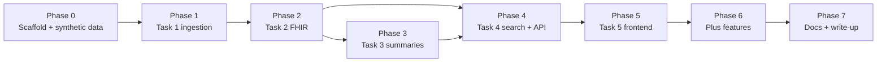

# 08. Delivery

## 1. Phase plan



Phase 4 indexes summaries, so it starts after Phase 3. The frontend shell (tokens, AppShell, router) may start during Phase 3 using MSW fixtures from `04-API-CONTRACT.md`.

Per phase loop: plan mode → tests → implementation → `make check` → code review → README update → commits on `main` as in section 3.

## 2. Phases

### Phase 0: Scaffold and synthetic data
**Build:** repo layout (`02-ARCHITECTURE.md` section 10), uv project, Vite app with Tailwind v4 + shadcn init, tokens from `06-UI-DESIGN.md` section 10, AppShell with themed empty pages, Makefile (with `help`), pre-commit (ruff, mypy, eslint, prettier, gitleaks, commitlint), CI skeleton including the security job, `.env.example`, `.editorconfig`, PR template, CODEOWNERS, Dependabot, `SECURITY.md`, `CHANGELOG.md`, synthetic generator with `_ground_truth.json` and the adversarial note, ADR files stubbed.
**Accept:** clean clone → `make setup && make data` works; `make check` green; app shows themed shell in light and dark.
**Commit:** `chore: scaffold monorepo, tooling, CI and synthetic EHR data generator`

### Phase 1: Task 1 ingestion and cleaning
**Build order:** models → cleaners (TDD, `05-ALGORITHMS.md` 1.2 to 1.3) → readers → identity → dedupe → audit → pipeline → repository → `ehr-mip ingest`.
**Accept:** FR-1.1 to FR-1.11 checks in `01-SPEC.md` section 7.
**Commit:** `feat(ingestion): multi-format EHR ingestion with cleaning, identity resolution and audit log (Task 1)`

### Phase 2: Task 2 FHIR normalization
**Build order:** codes and ids → mappers (TDD) → BundleBuilder → validator + reports → BundleStore → `ehr-mip normalize`.
**Accept:** FR-2.1 to FR-2.7.
**Commit:** `feat(fhir): FHIR R4 mapping, bundle validation report and SQLite store (Task 2)`

### Phase 3: Task 3 summarization
**Build order:** schemas → anomalies → context builder (de-identification test) → versioned prompt files + snapshot test → providers (Fake, Extractive, Anthropic) → guardrails → cache → `llm_calls` telemetry → token budget guard → service → `ehr-mip summarize` → golden and adversarial sets → evaluator → `make eval`.
**Accept:** FR-3.1 to FR-3.5, FR-6.5, FR-7.1 (FR-3.6 to 3.8 and FR-7.3, 7.4 are cheap here; include them).
**Commit:** `feat(summarization): structured Claude clinical summaries with guardrails and caching (Task 3)`

### Phase 4: Task 4 search and API
**Build order:** chunker → embedder → vector store → filters → lexical → ranking → SearchService → app factory, middleware (request id, timing, security headers, body limit), errors, rate limiting, log redaction → CacheBackend (memory) + search cache + `index_version` → system, search, patients (6, 7, 8), resources endpoints → `/metrics` → contract snapshot → security tests → perf test → `ehr-mip index`, `run-all`.
**Accept:** FR-4.1 to FR-4.4, FR-6.1 to 6.4, FR-9.1 (memory), FR-9.3, NFR-01, every R endpoint in `04-API-CONTRACT.md` matches its examples.
**Commit:** `feat(search): semantic search over FHIR records with ChromaDB and POST /search (Task 4)`

### Phase 5: Task 5 frontend
**Build order:** providers + router + query client → api-client (problem+json, 429 handling) + Zod schemas + contract fixture test → `copy.ts` microcopy → Storybook setup → SearchPage (input, filters, list, card, "why this result", states) → PatientDrawer (header, AI summary panel per `06-UI-DESIGN.md` §12, records, dialog) → keyboard model → responsive pass → axe tests → Playwright e2e → visual QA per `06-UI-DESIGN.md` section 11.
**Accept:** FR-5.1 to FR-5.6, FR-8.1, FR-8.2 (R parts), NFR-04.
**Commit:** `feat(frontend): clinician search and patient summary UI with filters and keyboard navigation (Task 5)`

### Phase 6: Plus features
**Order:** extractive fallback polish → hybrid search + MRN lookup → highlights → evidence links → hover prefetch → URL state → summary feedback (endpoint 20) + confidence popover → data quality page + endpoints 12, 14 to 17 (with LLM and feedback stats) → patient directory + endpoint 5 → shortcuts dialog + onboarding tip → dark mode → Storybook stories + a11y addon → performance budget (code splitting, size-limit, Lighthouse CI) → Docker with hardened containers + Redis profile + CI e2e, image scan, SBOM. Then P2 if time: timeline, bundle download, JSON viewer, regenerate, admin endpoints with token, HL7 validator target, recent searches, visual regression, OpenTelemetry, usability test.
**Accept:** each feature tested; nothing in R regresses.
**Commit:** `feat: hybrid search, AI feedback, data quality dashboard, caching, security hardening and DX improvements`

### Phase 7: Docs and write-up
**Build:** README, ADRs filled, `docs/AI_SYSTEM_CARD.md`, eval report + manual review, heuristic review (`docs/ux/heuristic-review.md`), `WRITEUP.md` → PDF, screenshots, CHANGELOG, final clean-clone run.
**Commit:** `docs: README, architecture decisions, evaluation results and write-up`

## 3. Commit history on main

`main` has one conventional commit per coherent change. The commit that completes each major task ends with its number:

```
feat(ingestion): add the ingest pipeline and command with tests (Task 1)
feat(fhir): add the normalize command with tests and report (Task 2)
feat(summarization): add summarize and eval commands with tests (Task 3)
feat(api): serve search, patients and resources with tests (Task 4)
feat(frontend): add the search page, stories and tests (Task 5)
```

The work was first delivered as eight phase commits. On 2026-11-22 they were split by change without altering their content, so commits from one phase share that phase's author date.

## 4. Makefile targets

`help, setup, data, ingest, normalize, summarize, index, pipeline, api, web, dev, test, test-backend, test-frontend, e2e, lint, fmt, typecheck, check, security, eval, openapi, storybook, lighthouse, validate-official (P2), docker-up, docker-up-redis, writeup-pdf, clean`.
`writeup-pdf`: `scripts/render_writeup.py` (markdown-it-py and the Playwright Chromium, nothing to download). It fails if the write-up is longer than one page.

## 5. README outline

1. Overview paragraph and screenshot (search with drawer open).
2. Quick start with Docker: `cp .env.example .env && docker compose up` → `http://localhost:8080`.
3. Local dev: Python 3.12, uv, Node 20+, pnpm; `make setup`, `make data`, `make pipeline`, `make dev`.
4. Tests: `make test`, `make e2e`, coverage.
5. Pipeline CLI reference.
6. API summary table (link to `docs/04-API-CONTRACT.md` and `/docs`).
7. Design decisions (link ADRs).
8. Data and privacy (synthetic only, de-identified LLM context).
9. Project structure.
10. Known limitations.

## 6. Write-up outline (`docs/WRITEUP.md`, one page)

- **Tradeoffs and why:** R4B package for R4 under Pydantic v2; Chroma over FAISS; local MiniLM over API embeddings (privacy, cost, offline); stdlib SQLite; conservative identity resolution; US date policy with audit; small Claude tier with guardrails; extractive fallback.
- **Security and AI design choices (one line each):** de-identified LLM context, prompt injection defense, rate limits and headers, eval gates, feedback loop.
- **With more time:** SMART on FHIR auth and access audit; clinical NER (scispaCy or MedCAT) and SNOMED coding; OCR for image PDFs; Practitioner and Organization resources; cross-encoder reranking; HAPI FHIR server; role-based access; larger clinician evaluation.
- **FHIR and clinical concepts researched:** Bundle types and `urn:uuid` references; DocumentReference vs DiagnosticReport; Observation interpretation and reference ranges; LOINC document codes; v2-0074 sections; AdministrativeGender; identifier `use=old` for merged MRNs; R4 vs R4B.
- **How summary quality was validated:** metrics table from `reports/eval_report.md`, guardrail intervention rate, manual review results.

Style: concise and natural, no em-dashes, no marketing tone.

## 7. Final submission checklist

- [ ] Public GitHub repo; `git log` matches section 3.
- [ ] Clean clone: `docker compose up` works without an API key (extractive mode).
- [ ] Clean clone: `make setup data pipeline dev` works; `make test` green.
- [ ] `backend/requirements.txt` and `pyproject.toml` both present.
- [ ] All tests runnable with `pytest` from `backend/`.
- [ ] README has setup and design decisions.
- [ ] `docs/WRITEUP.pdf` is one page.
- [ ] No real patient data; no secrets; `.env` absent.
- [ ] `reports/validation_report.md` and `reports/eval_report.md` samples committed.
- [ ] Screenshots in README match the current UI.
- [ ] `make security` clean; CI security and image jobs green.
- [ ] `docs/AI_SYSTEM_CARD.md` present and linked from README.
- [ ] Lighthouse scores ≥ 90 recorded in README.
- [ ] `docker compose --profile redis up` works and `/ready` shows `cache_backend: redis`.

## 8. Risks and mitigations

| Risk | Mitigation |
|---|---|
| torch install heavy | CPU wheel index; Docker layer caches model |
| Library API drift (Chroma, fhir.resources, TanStack v9, shadcn v4) | context7 lookups; lockfiles |
| R4 vs R4B questioned | ADR-001, optional HL7 validator, write-up note |
| LLM over 200 words or hallucinating | structured output, guardrails, eval, temperature 0 |
| No API key during review | extractive fallback, auto mode |
| Rate limits | concurrency cap, backoff, cache |
| Wrong identity merges | conservative rules; conflicts flagged, visible in UI |
| Lab noise in search | Observations not indexed by default; summaries indexed; hybrid mode |
| Scope creep | tier gates: no P1 before R green |
| Accessibility regressions | axe in unit and e2e; keyboard tests |
